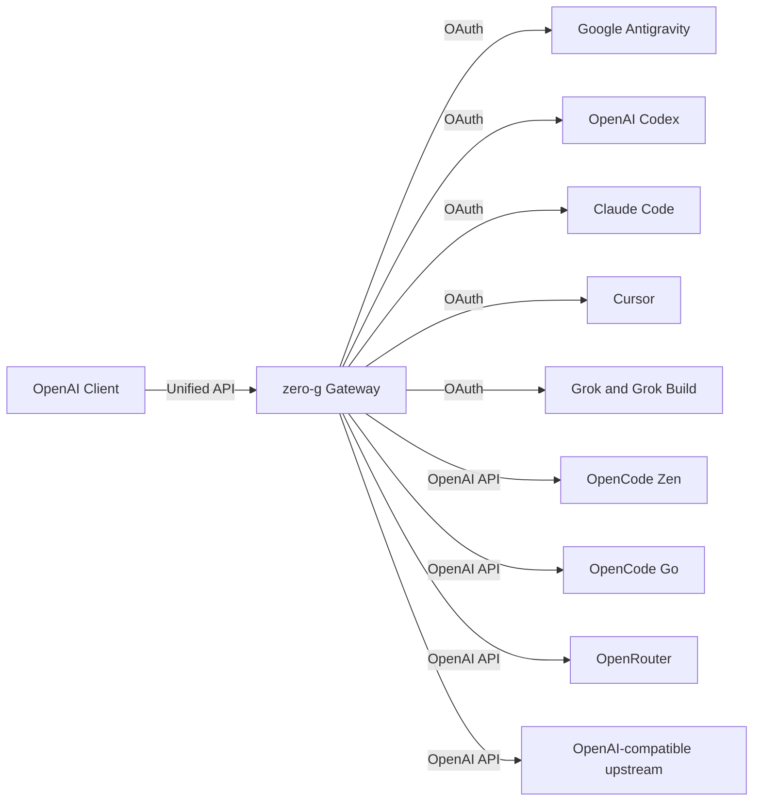

<div align="center">

# zero-g

**OpenAI-compatible AI gateway for multiple providers.**

[](https://github.com/Delnegend/zero-g/actions)
[](https://github.com/Delnegend/zero-g/releases)
[](#license)

</div>

---

## Quick Start

The current `latest` image is 0.5.8 and uses the older CLI; these instructions
apply after the next container image is published.

Download the Compose file and example settings, then set a stable encryption key
and a strong dashboard password in `.env`:

```bash
mkdir zero-g && cd zero-g
curl -fsSLo compose.yml https://raw.githubusercontent.com/Delnegend/zero-g/main/compose.yml
curl -fsSLo .env https://raw.githubusercontent.com/Delnegend/zero-g/main/.env.example
chmod 600 .env
# Generate the encryption key with: openssl rand -base64 32
# Edit .env to set ZERO_G_ENCRYPTION_KEY and ZERO_G_DASHBOARD_PASSWORD.
docker compose pull && docker compose up -d
curl --fail http://127.0.0.1:8080/health
```

Open `http://127.0.0.1:8080/` and sign in. Create the Antigravity provider under **Providers**, add a credential, and sign in. Under **Virtual keys**, create a key and copy it immediately; it is shown only once. Set `ZERO_G_VIRTUAL_KEY` to the copied value and use it as the bearer token for every inference request, including model discovery:

```bash
curl -H "Authorization: Bearer $ZERO_G_VIRTUAL_KEY" http://127.0.0.1:8080/v1/models
```

Use the returned model ID, such as `agy/gemini-3-pro`, in requests to the shared `/v1` API.

The API reference is available at `http://127.0.0.1:8080/redoc` after dashboard sign-in. Its OpenAPI document is at `/api/openapi.json`.

Configure retention under **Settings**, and configure providers and their accounts under **Providers**. Set the listening address with `ZERO_G_BIND` in `.env`. Authenticated request bodies and up to 256 KiB of each response are stored locally for 30 days by default. See [configuration](docs/configuration.md) and [deployment](docs/deployment.md) for secure setup and backups.
Under **Observability**, the **Dashboard** graphs request volume, outcomes, token usage, latency, providers and models. **LLM Logs** shows the latest 200 matching requests, searchable and sortable in pages of 20. Both pages filter by provider, model, path, status, virtual key or provider credential; the Dashboard also has a date filter. Select **View** to inspect a request in the right-side drawer, with JSON syntax highlighting for recorded bodies. On phones, requests appear as cards instead of a wide table. Dashboard pages have shareable URLs and support browser navigation.
The dashboard theme toggle follows your system preference initially and remembers your choice in the browser.


The published image is `ghcr.io/delnegend/zero-g:latest`; use a version tag to pin a release.

## Highlights

- **Unified API** — All providers share `/v1`; model IDs include the provider ID. OpenRouter Decisions models use `/v1/decisions`.
- **Multi-Provider Backends** — Connect Antigravity, Codex, Claude Code, Cursor, Grok, Grok Build, OpenCode Zen and Go, OpenRouter, and OpenAI-compatible upstreams.
- **OAuth Refresh** — Refreshes supported access tokens on demand when they approach expiration.
- **Claude & Gemini Support** — Formats Anthropic thinking beta headers, system instructions, and tool calling signatures automatically.
- **Multi-Turn Tool Calling** — End-to-end function declaration, execution, and tool response turn merging.

## Running

Use `docker compose up -d` to start the gateway on `127.0.0.1:8080`. Use the dashboard **Providers** page to create entries, sign in and inspect provider status. Discover models through the authenticated `/v1/models` endpoint.

See the [upgrade and backup guide](docs/deployment.md#upgrade-migration-and-backup) before upgrading.

For all environment variables, see **[Configuration Reference](docs/configuration.md)**.

## Architecture



For component boundaries, internal translation, and state invariants, see **[Architecture Guide](docs/architecture.md)**.

## Documentation

- **[Configuration](docs/configuration.md)** — Environment variables, dashboard settings, and credentials.
- **[Architecture](docs/architecture.md)** — Request envelopes, streaming translation, and invariants.
- **[Gateway Integration](docs/gateways.md)** — LiteLLM and Bifrost provider configuration.
- **[Deployment](docs/deployment.md)** — Container setup, updates, and backups.
- **[Development](docs/development.md)** — Prerequisites, `just check` gate, and test suite.

## License

Dual-licensed under [MIT](LICENSE-MIT) or [Apache-2.0](LICENSE-APACHE).
