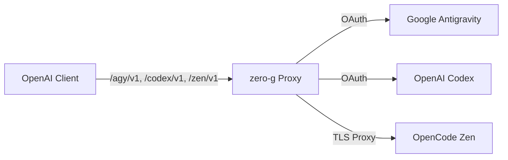

<div align="center">

# zero-g

**OpenAI-compatible proxy for Google Antigravity and OpenAI Codex subscriptions.**

[](https://github.com/Delnegend/zero-g/actions)
[](https://github.com/Delnegend/zero-g/releases)
[](#license)

</div>

---

## Quick Start

```bash
brew install Delnegend/tap/zero-g

# Generate once; keep the same key for every subsequent run and back it up.
export ZERO_G_ENCRYPTION_KEY="$(openssl rand -base64 32)"
export ZERO_G_DASHBOARD_AUTH=basic
export ZERO_G_DASHBOARD_ORIGIN=http://127.0.0.1:8080
export ZERO_G_DASHBOARD_USERNAME=admin
export ZERO_G_DASHBOARD_PASSWORD='replace-with-a-strong-password'
zero-g
```

Open `http://127.0.0.1:8080/` and sign in. Under **Virtual keys**, create a key and copy it immediately; it is shown only once. Set `ZERO_G_VIRTUAL_KEY` to the copied value and use it as the bearer token for every inference request, including model discovery:

```bash
curl -H "Authorization: Bearer $ZERO_G_VIRTUAL_KEY" http://127.0.0.1:8080/agy/v1/models
```

Configure retention, Zen and Google OAuth settings and provider credentials in the dashboard. Set the listening address with `ZERO_G_BIND` in `.env`. Full request and response bodies are stored locally for 30 days by default. See [configuration](docs/configuration.md) and [deployment](docs/deployment.md) for secure setup and backups.
Under **Observability**, the **Dashboard** shows totals and requests by UTC day; **LLM Logs** lets you search, sort, and inspect requests. On phones, requests appear as cards instead of a wide table. The chart and log list cover the latest 200 requests, while the summary covers all retained requests. Dashboard pages have shareable URLs and support browser navigation.
The dashboard theme toggle follows your system preference initially and remembers your choice in the browser.


Source builds from checkout: run `(cd web && bun install --frozen-lockfile) && just web-build` before `cargo install --path .`.

## Highlights

- **Standard OpenAI API per Provider** — Explicit `/agy/v1`, `/codex/v1`, and `/zen/v1` routes supporting `chat/completions`, `responses`, and `models`.
- **Multi-Provider Backends** — Seamless proxying for Google Antigravity (`/agy`), OpenAI Codex (`/codex`), and OpenCode Zen (`/zen`).
- **Auto-Refresh** — Refreshes expired OAuth tokens in the background automatically.
- **Claude & Gemini Support** — Formats Anthropic thinking beta headers, system instructions, and tool calling signatures automatically.
- **Multi-Turn Tool Calling** — End-to-end function declaration, execution, and tool response turn merging.

## Running

Run `zero-g` to start the proxy (default `127.0.0.1:8080`, configurable in Settings). Use the dashboard **Providers** page to sign in and inspect provider status. Discover models through the authenticated provider API as shown above.

The separate `zero-g-import-legacy` utility migrates databases from previous libSQL-based releases while the service is stopped. See the [upgrade guide](docs/deployment.md#upgrade-migration-and-backup).

For all environment variables, see **[Configuration Reference](docs/configuration.md)**.

## Architecture



For component boundaries, internal translation, and state invariants, see **[Architecture Guide](docs/architecture.md)**.

## Documentation

- **[Configuration](docs/configuration.md)** — Environment variables, dashboard settings, and credentials.
- **[Architecture](docs/architecture.md)** — Request envelopes, streaming translation, and invariants.
- **[Gateway Integration](docs/gateways.md)** — LiteLLM and Bifrost provider configuration.
- **[Deployment](docs/deployment.md)** — Homebrew services, systemd units, and upgrades.
- **[Development](docs/development.md)** — Prerequisites, `just check` gate, and test suite.

## License

Dual-licensed under [MIT](LICENSE-MIT) or [Apache-2.0](LICENSE-APACHE).
