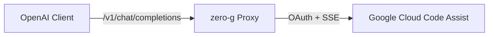

<div align="center">

# zero-g

**OpenAI-compatible proxy for Google Antigravity subscriptions.**

[](https://github.com/Delnegend/zero-g/actions)
[](https://github.com/Delnegend/zero-g/releases)
[](LICENSE)

</div>

---

## Quick Start

Get running in less than 60 seconds:

```bash
# 1. Install (Linux and macOS)
brew install Delnegend/tap/zero-g

# 2. Run
zero-g serve

# 3. Verify
curl http://localhost:8080/v1/models
```

Source builds from checkout: `cargo install --path .` (last resort only).

## Highlights

- **Standard OpenAI API** — Native `/v1/chat/completions`, `/v1/responses`, and `/v1/models` routes for modern AI tools and agents.
- **Auto-Refresh** — Refreshes expired Antigravity OAuth tokens in the background automatically.
- **Claude & Gemini Support** — Formats Anthropic thinking beta headers, system instructions, and tool calling signatures automatically.
- **Multi-Turn Tool Calling** — End-to-end function declaration, execution, and tool response turn merging.

## Common Options

```bash
# Start proxy (configured via .env or defaults to 127.0.0.1:8080)
zero-g serve --api-key sk-local-secret
```

| Option | Default | Description |
|---|---|---|
| `serve` | None | Start HTTP proxy server (default) |
| `--api-key <key>` | None | Optional Bearer authentication token |
| `login` | None | Interactive browser OAuth sign-in flow |
| `models` | None | List available models and quotas |
| `status` | None | Print token validity and project ID |
For all environment variables and advanced flags, see **[Configuration Reference](docs/configuration.md)**.

## Architecture



For component boundaries, internal translation, and state invariants, see **[Architecture Guide](docs/architecture.md)**.

## Roadmap

- [x] **Core Proxy & Protocol Translation** — Chat completions, Responses API, SSE streaming, and tool calling.
- [ ] **Homebrew Tap Distribution** — Packaged formula under `Delnegend/homebrew-tap`.
- [ ] **Daemon Service Units** — Automated systemd user unit and launchd configuration.

## Documentation

- **[Configuration](docs/configuration.md)** — Environment variables, flags, and credentials schema.
- **[Architecture](docs/architecture.md)** — Request envelopes, streaming translation, and invariants.
- **[Deployment](docs/deployment.md)** — Homebrew services, systemd units, and upgrades.
- **[Development](docs/development.md)** — Prerequisites, `just check` gate, and test suite.

## License

[MIT](LICENSE)
