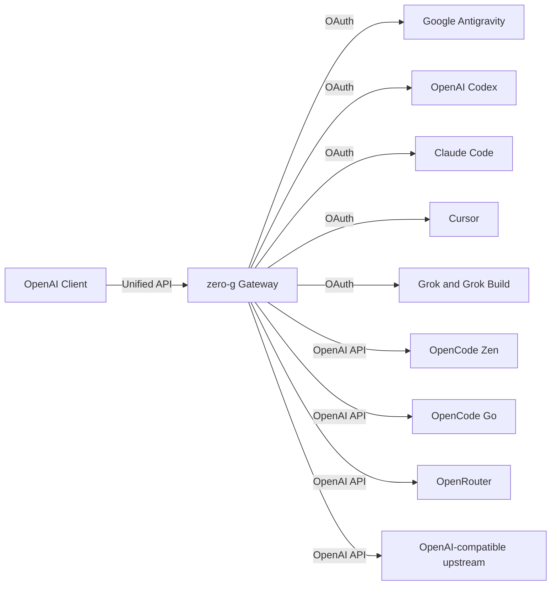

<div align="center">

# zero-g

**OpenAI-compatible AI gateway for multiple providers.**

[](https://github.com/Delnegend/zero-g/actions)
[](https://github.com/Delnegend/zero-g/releases)
[](#license)

</div>

---

## Quick Start

```bash
brew install Delnegend/tap/zero-g

# Generate once; keep the same key for every subsequent run and back it up.
export ZERO_G_ENCRYPTION_KEY="$(openssl rand -base64 32)"
export ZERO_G_DASHBOARD_AUTH=basic
export ZERO_G_DASHBOARD_ORIGIN=http://127.0.0.1:8080
export ZERO_G_DASHBOARD_USERNAME=admin
export ZERO_G_DASHBOARD_PASSWORD='replace-with-a-strong-password'
zero-g
```

Open `http://127.0.0.1:8080/` and sign in. Create the Antigravity provider under **Providers**, add a credential, and sign in. Under **Virtual keys**, create a key and copy it immediately; it is shown only once. Set `ZERO_G_VIRTUAL_KEY` to the copied value and use it as the bearer token for every inference request, including model discovery:

```bash
curl -H "Authorization: Bearer $ZERO_G_VIRTUAL_KEY" http://127.0.0.1:8080/v1/models
```

Use the returned model ID, such as `agy/gemini-3-pro`, in requests to the shared `/v1` API.

The API reference is available at `http://127.0.0.1:8080/redoc` after dashboard sign-in. Its OpenAPI document is at `/api/openapi.json`.

Configure retention under **Settings**, and configure providers and their accounts under **Providers**. Set the listening address with `ZERO_G_BIND` in `.env`. Full request and response bodies are stored locally for 30 days by default. See [configuration](docs/configuration.md) and [deployment](docs/deployment.md) for secure setup and backups.
Under **Observability**, the **Dashboard** shows totals and request trends for the selected time range; **LLM Logs** lets you search and sort the latest 200 requests in pages of 20. Select **View** to inspect a request in the right-side drawer, with JSON syntax highlighting for recorded bodies. On phones, requests appear as cards instead of a wide table. Dashboard pages have shareable URLs and support browser navigation.
The dashboard theme toggle follows your system preference initially and remembers your choice in the browser.


Source builds from checkout: run `(cd frontend && bun install --frozen-lockfile) && just frontend-build` before `cargo install --path .`.

## Highlights

- **Unified API** — All providers share `/v1`; model IDs include the provider ID to distinguish identical names.
- **Multi-Provider Backends** — Connect Antigravity, Codex, Claude Code, Cursor, Grok, Grok Build, OpenCode Zen and Go, OpenRouter, and OpenAI-compatible upstreams.
- **OAuth Refresh** — Refreshes supported access tokens on demand when they approach expiration.
- **Claude & Gemini Support** — Formats Anthropic thinking beta headers, system instructions, and tool calling signatures automatically.
- **Multi-Turn Tool Calling** — End-to-end function declaration, execution, and tool response turn merging.

## Running

Run `zero-g` to start the gateway (default `127.0.0.1:8080`, configurable with `ZERO_G_BIND`). Use the dashboard **Providers** page to create entries, sign in and inspect provider status. Discover models through the authenticated `/v1/models` endpoint.

See the [upgrade and backup guide](docs/deployment.md#upgrade-migration-and-backup) before upgrading.

For all environment variables, see **[Configuration Reference](docs/configuration.md)**.

## Architecture



For component boundaries, internal translation, and state invariants, see **[Architecture Guide](docs/architecture.md)**.

## Documentation

- **[Configuration](docs/configuration.md)** — Environment variables, dashboard settings, and credentials.
- **[Architecture](docs/architecture.md)** — Request envelopes, streaming translation, and invariants.
- **[Gateway Integration](docs/gateways.md)** — LiteLLM and Bifrost provider configuration.
- **[Deployment](docs/deployment.md)** — Homebrew services, systemd units, and upgrades.
- **[Development](docs/development.md)** — Prerequisites, `just check` gate, and test suite.

## License

Dual-licensed under [MIT](LICENSE-MIT) or [Apache-2.0](LICENSE-APACHE).
