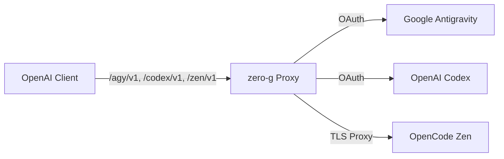

<div align="center">

# zero-g

**OpenAI-compatible proxy for Google Antigravity and OpenAI Codex subscriptions.**

[](https://github.com/Delnegend/zero-g/actions)
[](https://github.com/Delnegend/zero-g/releases)
[](#license)

</div>

---

## Quick Start

```bash
brew install Delnegend/tap/zero-g

# Generate once; keep the same key for every subsequent run and back it up.
export ZERO_G_ENCRYPTION_KEY="$(openssl rand -base64 32)"
export ZERO_G_DASHBOARD_AUTH=basic
export ZERO_G_DASHBOARD_ORIGIN=http://127.0.0.1:8080
export ZERO_G_DASHBOARD_USERNAME=admin
export ZERO_G_DASHBOARD_PASSWORD='replace-with-a-strong-password'
zero-g serve
```

Open `http://127.0.0.1:8080/` and sign in. Under **Virtual keys**, create a key and copy it immediately; it is shown only once. Set `ZERO_G_VIRTUAL_KEY` to the copied value and use it as the bearer token for every inference request, including model discovery:

```bash
curl -H "Authorization: Bearer $ZERO_G_VIRTUAL_KEY" http://127.0.0.1:8080/agy/v1/models
```

Configure provider credentials and persisted bind, retention, Zen and Google OAuth settings in the dashboard. Full request and response bodies are stored locally for 30 days by default. See [configuration](docs/configuration.md) and [deployment](docs/deployment.md) for secure setup and backups.


Source builds from checkout: run `(cd web && bun install --frozen-lockfile) && just web-build` before `cargo install --path .`.

## Highlights

- **Standard OpenAI API per Provider** — Explicit `/agy/v1`, `/codex/v1`, and `/zen/v1` routes supporting `chat/completions`, `responses`, and `models`.
- **Multi-Provider Backends** — Seamless proxying for Google Antigravity (`/agy`), OpenAI Codex (`/codex`), and OpenCode Zen (`/zen`).
- **Auto-Refresh** — Refreshes expired OAuth tokens in the background automatically.
- **Claude & Gemini Support** — Formats Anthropic thinking beta headers, system instructions, and tool calling signatures automatically.
- **Multi-Turn Tool Calling** — End-to-end function declaration, execution, and tool response turn merging.

## Common Commands

```bash
# Start proxy (defaults to 127.0.0.1:8080 until changed in Settings)
zero-g serve
```

| Command | Description |
|---|---|
| `serve` | Start HTTP proxy server (default) |
| `login <provider>` | Interactive OAuth sign-in flow (`zero-g login agy` or `zero-g login codex`) |
| `models <provider>` | List available models (`zero-g models agy`, `zero-g models codex`, `zero-g models zen`) |
| `status [provider]` | Print token validity, project ID, and account status |

For all environment variables, see **[Configuration Reference](docs/configuration.md)**.

## Architecture



For component boundaries, internal translation, and state invariants, see **[Architecture Guide](docs/architecture.md)**.

## Documentation

- **[Configuration](docs/configuration.md)** — Environment variables, flags, and credentials schema.
- **[Architecture](docs/architecture.md)** — Request envelopes, streaming translation, and invariants.
- **[Gateway Integration](docs/gateways.md)** — LiteLLM and Bifrost provider configuration.
- **[Deployment](docs/deployment.md)** — Homebrew services, systemd units, and upgrades.
- **[Development](docs/development.md)** — Prerequisites, `just check` gate, and test suite.

## License

Dual-licensed under [MIT](LICENSE-MIT) or [Apache-2.0](LICENSE-APACHE).
