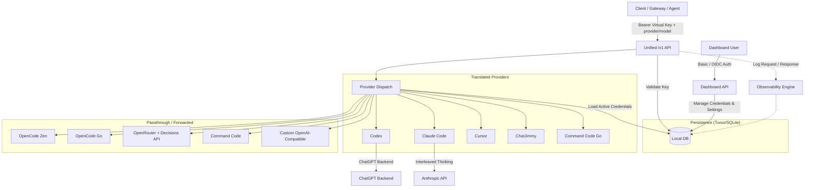
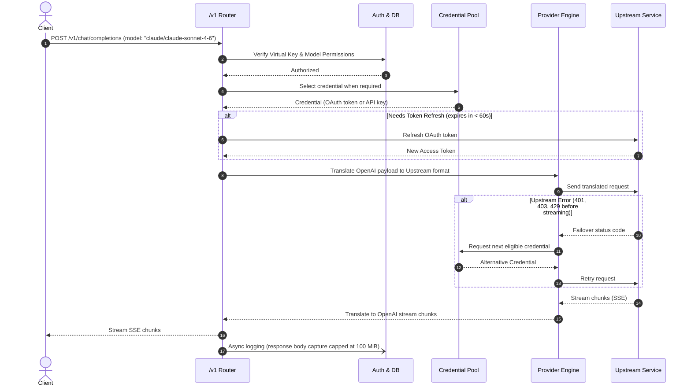

# Architecture

Zero-G provides a unified OpenAI-compatible interface (`/v1`) that translates and dispatches requests across multiple upstream LLM providers, with credential pooling, local SQLite/Turso persistence, and an integrated management dashboard.

---

## Core Components

| Component                | Path / Location                                                | Responsibility                                                                                                                                                                                            |
| ------------------------ | -------------------------------------------------------------- | --------------------------------------------------------------------------------------------------------------------------------------------------------------------------------------------------------- |
| **HTTP Layer**           | `backend/server/`                                              | Axum web server exposing `/v1` inference and dashboard endpoints.                                                                                                                                         |
| **Dashboard Auth**       | `backend/server/dashboard_auth_config.rs`                      | Maps configuration to `axum-auth-gate` (Basic and OIDC + PKCE).                                                                                                                                           |
| **Protocol Types**       | `backend/openai.rs`, `backend/responses.rs`                    | Strongly typed Serde models for Chat Completions and Responses API.                                                                                                                                       |
| **Auth Managers**        | `backend/provider/*/auth.rs`                                   | Token lifecycle, credential locking, and provider-specific refreshes.                                                                                                                                     |
| **Provider System**      | `backend/provider/common/`, `backend/provider/*/`              | Provider traits for routing and model discovery.                                                                                                                                                          |
| **Credential Pools**     | `backend/provider/credentials/`                                | Encrypted credential storage and weighted selection; rate-limited credentials enter an in-memory cooldown and are skipped until retry. Cooldowns are local to each running instance and reset on restart. |
| **Catalog & Datasheets** | `backend/provider/catalog.rs`, `backend/server/model_setting/` | Model metadata, pricing synchronization, and background discovery polling.                                                                                                                                |
| **Storage & Migrations** | `backend/database.rs`, `backend/storage.rs`                    | Toasty ORM over SQLite/Turso with retry-aware transactions and startup migrations.                                                                                                                        |

---

## Request & Data Flow

---

## Invariants & Protocol Guarantees

| Invariant                 | Scope                           | Rule                                                                                                                                                   |
| ------------------------- | ------------------------------- | ------------------------------------------------------------------------------------------------------------------------------------------------------ |
| **OAuth Token Refresh**   | Codex                           | Checked before request; if expiration is within 60s, token refresh triggers automatically.                                                             |
| **Interrupted Streams**   | Codex                           | Broken streams without terminal response raise a clean downstream error instead of a truncated success marker.                                         |
| **Payload Size Limit**    | Unified inference POST requests | Request bodies capped at 20,000,000 bytes. Response body capture capped at 100 MiB.                                                                    |
