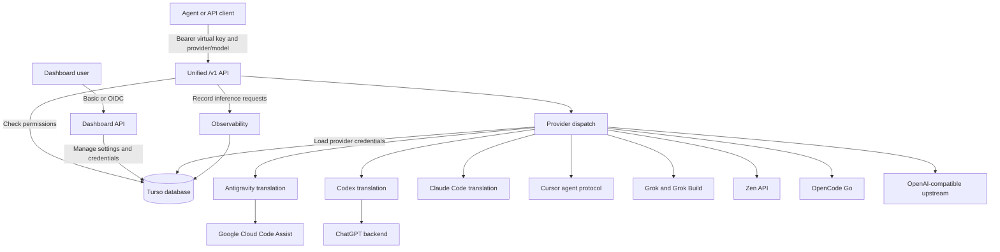

# Architecture

## Overview

`zero-g` exposes one OpenAI-compatible API for multiple providers. Requests name a provider and model, such as `codex/gpt-5.3-codex`. Antigravity, Codex, Claude Code and Cursor requests are translated to their upstream protocols; Grok and Grok Build use separate xAI and CLI-proxy endpoints. OpenCode Go, Zen and custom OpenAI-compatible providers are forwarded. Provider credentials, virtual keys, settings and request logs are stored in the local database.

## Core Components

- **Axum HTTP Layer (`backend/server/`):** The unified `/v1` API requires a virtual key and dispatches `provider/model` IDs to provider-owned routers. Dashboard authentication and observability remain separate.
- **Server endpoints (`backend/server/`):** Endpoint handlers live in dedicated files within their feature directories; shared storage, authentication, and middleware stay alongside them.
- **Dashboard authentication (`backend/server/dashboard_auth_config.rs`):** Maps Zero-G configuration to `axum-auth-gate`, which implements Basic and OIDC authentication, discovery, PKCE, token exchange, signed ID-token validation, and process-local sessions. Signing keys are refreshed at login.
- **Protocol Models (`backend/openai.rs`, `backend/responses.rs`):** Strongly typed Serde models for Chat Completions and Responses API inputs (prompts, messages, tool outputs).
- **Auth Managers (`backend/provider/antigravity/auth.rs`, `backend/provider/codex/auth.rs`):** Load encrypted OAuth credentials and refresh access tokens near a known expiration. Codex also reads account information from its token.
- **Login Flows (`backend/provider/*/dashboard_login.rs`):** Each OAuth provider owns its dashboard sign-in and pending state. `backend/provider/login.rs` contains shared origin and credential checks and refresh locks.
- **Provider interface (`backend/provider/common/`):** The `Provider` trait exposes model discovery and inference routers; separate traits describe optional quota and dashboard routes. Shared upstream errors and OpenAI-compatible proxy checks live alongside them. `ProviderKind` in `backend/provider/mod.rs` registers implementations and dispatches without boxed futures.
- **Provider routes (`backend/provider/*/`):** Each provider owns its protocol handling, model discovery and account-specific operations.
- **Provider kinds (`backend/provider/mod.rs`):** Provider descriptors own labels and credential capabilities; the dashboard loads them from `/api/provider-kinds`.
- **Credential pools (`backend/provider/credentials.rs`):** Store separately encrypted API keys and OAuth sessions per provider. Selection draws enabled, connected credentials in weighted order; upstream 401, 403 and 429 responses permit trying another credential before a response is sent. Legacy migration preserves credentials and refuses merges that would widen a virtual key's access.
- **Model catalog (`backend/provider/catalog.rs`, `backend/server/model_catalog/`, `backend/server/model_setting/`):** Discovers models per provider, persists the last results and synchronized pricing/parameter datasheets, and refreshes them on configurable schedules. Discovery and both model-list endpoints share the `Model` type in `backend/openai.rs`, retaining extra provider metadata alongside common fields. The dashboard catalog combines these records with current cached datasheets and returns normalized display details and prices per million tokens; `/v1/models` keeps its OpenAI-compatible format. A failed provider or datasheet sync retains the last successful data.
- **Model settings endpoints (`backend/server/model_setting/`):** `get.rs`, `update.rs`, and `sync.rs` own their respective API actions and tests; `datasheet.rs` handles downloads and filtering, and `schedule.rs` handles background refreshes.
- **OpenAI-compatible provider (`backend/provider/openai/`):** Forwards model discovery, Chat Completions and Responses requests to the configured upstream API without translating between the two protocols.
- **OpenCode Go (`backend/provider/go/`):** Forwards both OpenAI APIs with the supplied session header, discovers Go models, and uses the same weighted credential failover.
- **Account usage (`backend/provider/quota.rs`):** Dispatches to provider-owned quota implementations; Zen balance uses a separately encrypted Console session and workspace ID. The dashboard caches responses for five minutes.
- **Codex tool history:** Function-call arguments are sent upstream as JSON strings, including when a Responses request supplies an object.
- **Stream Parsers (`backend/provider/antigravity/stream.rs`, `backend/provider/codex/client.rs`):** Decode upstream SSE streams into standard OpenAI chat completion chunks or Responses API lifecycle events.
- **Storage (`backend/database.rs`, `backend/storage.rs`):** A shared Toasty connection pool serves providers, settings, encrypted secrets, virtual keys and request logs. The settings store holds its validated 32-byte encryption key as an `EncryptionKey` type. Related changes use `transaction_with_retry!` to start a fresh transaction for each attempt; write conflicts are retried for up to five seconds, and callers decide whether to commit. Dashboard summaries use a consistent read snapshot. Embedded migrations run at startup.
## Invariants & Guarantees

- **OAuth Token Refresh:** When an Antigravity or Codex credential has a known expiration within 60 seconds, zero-g attempts to refresh it before the upstream request. Antigravity leaves credentials unchanged if no refresh token is available; Codex reports an error.
- **Antigravity Endpoint Failover:** Generation and model discovery try `daily-cloudcode-pa.googleapis.com` first, then the sandbox endpoint after a connection failure or upstream 5xx response.
- **Thought Signatures:** Antigravity returns signed text and reasoning in `provider_parts` and signed tool calls in `thought_signature`. Clients that replay these fields preserve signatures for the same provider and model. An unsigned first tool call uses `skip_thought_signature_validator`; later calls retain their order.
- **Contiguous Tool Turns:** Consecutive tool results merge into a single contiguous `role: "user"` turn as required by Cloud Code Assist.
- **Interrupted Translated Streams:** For Antigravity and Codex, an upstream failure or a stream ending without a terminal response is reported as an error rather than a successful completion. OpenAI-compatible pass-through streams retain upstream behavior.
- **Claude Wire Handling:** Antigravity Claude requests include `anthropic-beta: interleaved-thinking-2025-05-14`. Tool mode follows the requested tool choice, defaulting to `VALIDATED`; requested output tokens are capped by the discovered model limit when one is available.
