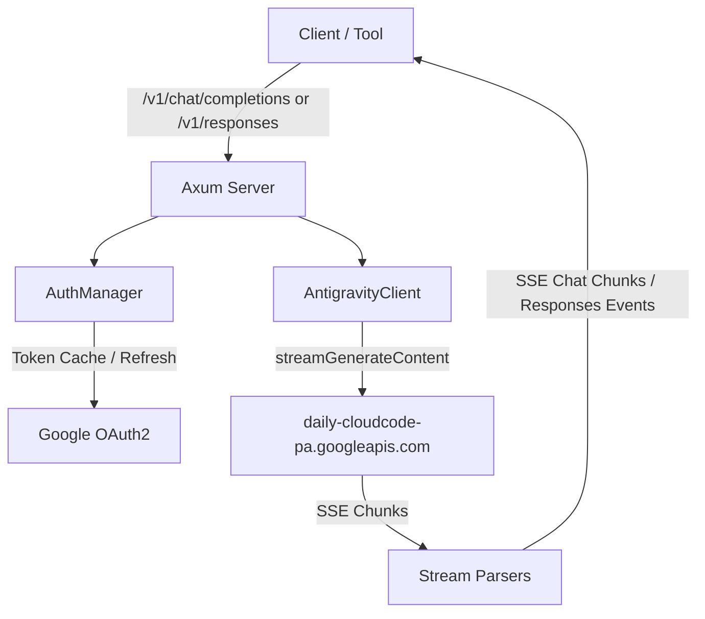

# Architecture

## Overview

`zero-g` translates standard OpenAI Chat Completions and Responses API requests into Google Cloud Code Assist (CCA) requests and OpenAI Codex backend requests, decoding upstream server-sent events into standard OpenAI chunk streams and event notifications. It handles Google OAuth2 and ChatGPT OAuth PKCE/device lifecycle management, companion project discovery, and model-specific protocol quirks transparently.

## Core Components

- **Axum HTTP Layer (`backend/server/`):** The unified `/v1` API requires a virtual key and dispatches `provider/model` IDs to provider-owned routers. Dashboard authentication and observability remain separate.
- **Dashboard OIDC (`backend/server/dashboard_auth.rs`):** Uses `openidconnect` for discovery, PKCE, token exchange and signed ID-token validation. Signing keys are refreshed at login; local sessions and email/group authorization remain in zero-g.
- **Protocol Models (`backend/openai.rs`, `backend/responses.rs`):** Strongly typed Serde models for Chat Completions and Responses API inputs (prompts, messages, tool outputs).
- **Auth Managers (`backend/provider/antigravity/auth.rs`, `backend/provider/codex/auth.rs`):** Store provider credentials encrypted in the database, parse JWT claims, and refresh access tokens near expiration.
- **Login Flows (`backend/provider/*/dashboard_login.rs`):** Each OAuth provider owns its dashboard sign-in and pending state. `backend/provider/login.rs` contains shared origin and credential checks and refresh locks.
- **Provider interface (`backend/provider/common/`):** The `Provider` trait exposes model discovery and inference routers; separate traits describe optional quota and dashboard routes. Shared upstream errors and OpenAI-compatible proxy checks live alongside them. `ProviderKind` in `backend/provider/mod.rs` registers implementations and dispatches without boxed futures.
- **Provider routes (`backend/provider/*/`):** Each provider owns its protocol handling, model discovery and account-specific operations. Zen's shim management lives in `backend/provider/zen/shim.rs`.
- **Provider kinds (`backend/provider/mod.rs`):** Provider descriptors own labels and credential capabilities; the dashboard loads them from `/api/provider-kinds`.
- **Credential pools (`backend/provider/credentials.rs`):** Store separately encrypted API keys and OAuth sessions per provider. Selection draws enabled, connected credentials in weighted order; upstream 401, 403 and 429 responses permit trying another credential before a response is sent. Legacy migration preserves credentials and refuses merges that would widen a virtual key's access.
- **Model catalog (`backend/provider/catalog.rs`, `backend/server/model_catalog.rs`, `backend/server/model_settings.rs`):** Discovers models per provider, persists the last results and synchronized pricing/parameter datasheets, and refreshes them on configurable schedules. A failed provider or datasheet sync retains the last successful data.
- **OpenAI-compatible provider (`backend/provider/openai/`):** Forwards model discovery, Chat Completions and Responses requests to the configured upstream API without translating between the two protocols.
- **OpenCode Go (`backend/provider/go/`):** Forwards both OpenAI APIs with the supplied session header, discovers Go models, and uses the same weighted credential failover.
- **Account usage (`backend/provider/quota.rs`):** Dispatches to provider-owned quota implementations; Zen balance uses a separately encrypted Console session and workspace ID. The dashboard caches responses for five minutes.
- **Codex tool history:** Function-call arguments are sent upstream as JSON strings, including when a Responses request supplies an object.
- **Stream Parsers (`backend/provider/antigravity/stream.rs`, `backend/provider/codex/client.rs`):** Decode upstream SSE streams into standard OpenAI chat completion chunks or Responses API lifecycle events.
- **Storage (`backend/database.rs`, `backend/storage.rs`):** A shared Toasty connection pool serves providers, settings, encrypted secrets, virtual keys and request logs. The settings store holds its validated 32-byte encryption key as an `EncryptionKey` type. Related changes use database transactions; write conflicts are retried for up to five seconds. Dashboard summaries use a consistent read snapshot. Embedded migrations run at startup.
## Invariants & Guarantees

- **Token Freshness:** Any request dispatched with a token expiring within 60 seconds triggers a refresh before the upstream connection opens.
- **Failover Delivery:** Requests attempt `daily-cloudcode-pa.googleapis.com` first and fail over to `daily-cloudcode-pa.sandbox.googleapis.com` on transient server errors.
- **Thought Signatures:** Antigravity returns signed text and reasoning in `provider_parts` and signed tool calls in `thought_signature`. Clients that replay these fields preserve signatures for the same provider and model. An unsigned first tool call uses `skip_thought_signature_validator`; later calls retain their order.
- **Contiguous Tool Turns:** Consecutive tool results merge into a single contiguous `role: "user"` turn as required by Cloud Code Assist.
- **Interrupted Streams:** An upstream failure or a stream ending without a terminal response is reported as an error rather than a successful completion.
- **Claude Wire Compliance:** Claude requests enforce `functionCallingConfig.mode: "VALIDATED"`, inject `anthropic-beta: interleaved-thinking-2025-05-14`, and cap output tokens at 64,000.
