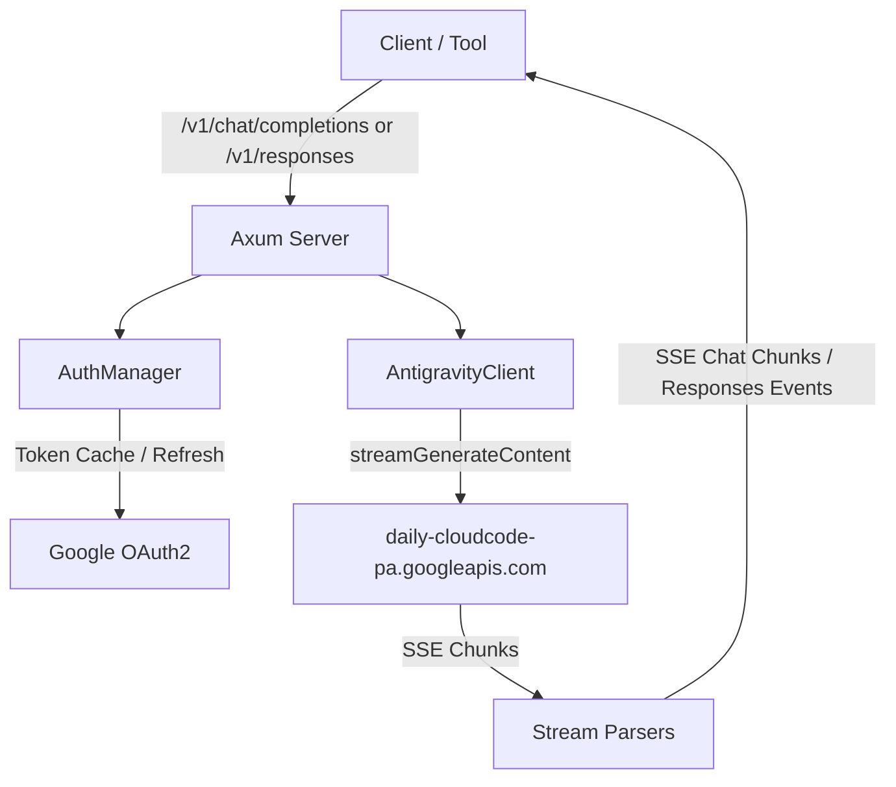

# Architecture

## Overview

`zero-g` translates standard OpenAI Chat Completions and Responses API requests into Google Cloud Code Assist (CCA) requests and OpenAI Codex backend requests, decoding upstream server-sent events into standard OpenAI chunk streams and event notifications. It handles Google OAuth2 and ChatGPT OAuth PKCE/device lifecycle management, companion project discovery, and model-specific protocol quirks transparently.

## Core Components

- **Axum HTTP Layer (`backend/server/`):** Exposes provider-specific routes (`/agy/v1`, `/codex/v1`, `/zen/v1`, `/openai/v1`) requiring virtual-key Bearer authentication. Dashboard authentication is separate. Unprefixed routes are rejected.
- **Dashboard OIDC (`backend/server/dashboard_auth.rs`):** Uses `openidconnect` for discovery, PKCE, token exchange and signed ID-token validation. Signing keys are refreshed at login; local sessions and email/group authorization remain in zero-g.
- **Protocol Models (`backend/openai.rs`, `backend/responses.rs`):** Strongly typed Serde models for Chat Completions and Responses API inputs (prompts, messages, tool outputs).
- **Auth Managers (`backend/provider/antigravity/auth.rs`, `backend/provider/codex/auth.rs`):** Store provider credentials encrypted in the database, import legacy plaintext files once, parse JWT claims, and refresh access tokens near expiration.
- **Login Flows (`backend/provider/antigravity/login.rs`, `backend/provider/codex/login.rs`):** Run local OAuth callbacks with device-code flow for headless Codex environments.
- **Wire Translators (`backend/provider/antigravity/`, `backend/provider/codex/`, `backend/provider/zen.rs`):** Translate provider requests and responses; Zen's shim management lives in `backend/provider/shim.rs`.
- **OpenAI-compatible provider (`backend/provider/openai.rs`):** Forwards model discovery, Chat Completions and Responses requests to the configured upstream API without translating between the two protocols.
- **Codex tool history:** Function-call arguments are sent upstream as JSON strings, including when a Responses request supplies an object.
- **Stream Parsers (`backend/provider/antigravity/stream.rs`, `backend/provider/codex/client.rs`):** Decode upstream SSE streams into standard OpenAI chat completion chunks or Responses API lifecycle events.
- **Storage:** Toasty with the Turso driver stores settings, encrypted secrets, virtual keys and request logs; embedded migrations run at startup.
## Invariants & Guarantees

- **Token Freshness:** Any request dispatched with a token expiring within 60 seconds triggers a refresh before the upstream connection opens.
- **Failover Delivery:** Requests attempt `daily-cloudcode-pa.googleapis.com` first and fail over to `daily-cloudcode-pa.sandbox.googleapis.com` on transient server errors.
- **Thought Signature Bypass:** Replayed assistant tool calls carry `thoughtSignature: "skip_thought_signature_validator"` to prevent Gemini 3 validation failures.
- **Contiguous Tool Turns:** Consecutive tool results merge into a single contiguous `role: "user"` turn as required by Cloud Code Assist.
- **Claude Wire Compliance:** Claude requests enforce `functionCallingConfig.mode: "VALIDATED"`, inject `anthropic-beta: interleaved-thinking-2025-05-14`, and cap output tokens at 64,000.
