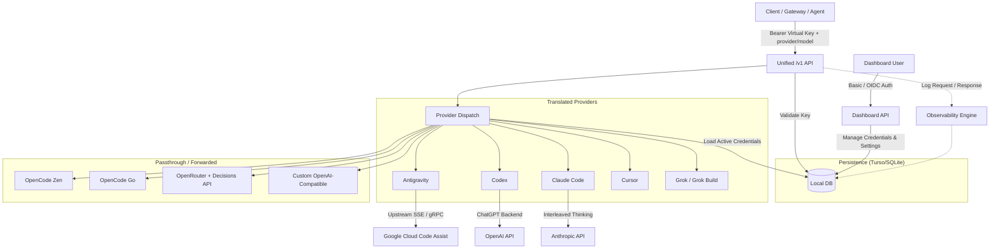
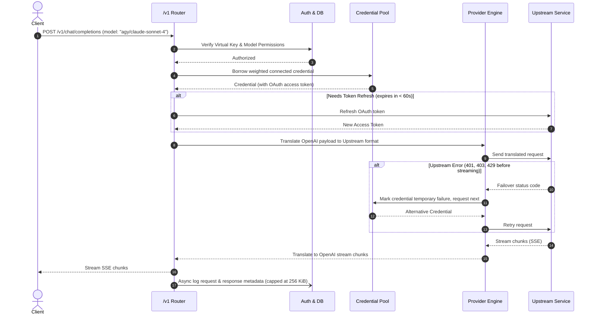

# Architecture

Zero-G provides a unified OpenAI-compatible interface (`/v1`) that translates and dispatches requests across multiple upstream LLM providers, with credential pooling, local SQLite/Turso persistence, and an integrated management dashboard.

---

## Core Components

| Component | Path / Location | Responsibility |
|---|---|---|
| **HTTP Layer** | `backend/server/` | Axum web server exposing `/v1` inference and dashboard endpoints. |
| **Dashboard Auth** | `backend/server/dashboard_auth_config.rs` | Maps configuration to `axum-auth-gate` (Basic and OIDC + PKCE). |
| **Protocol Types** | `backend/openai.rs`, `backend/responses.rs` | Strongly typed Serde models for Chat Completions and Responses API. |
| **Auth Managers** | `backend/provider/*/auth.rs` | Token lifecycle, credential locking, and provider-specific refreshes. |
| **Provider System** | `backend/provider/common/`, `backend/provider/*/` | `Provider` trait for routing, discovery, streaming, and error normalization. |
| **Credential Pools** | `backend/provider/credentials.rs` | Encrypted credential storage, weighted load-balancing, and automatic failover on 401/403/429. |
| **Catalog & Datasheets** | `backend/provider/catalog.rs`, `backend/server/model_setting/` | Model metadata, pricing synchronization, and background discovery polling. |
| **Storage & Migrations** | `backend/database.rs`, `backend/storage.rs` | Toasty ORM over SQLite/Turso with retry-aware transactions and startup migrations. |

---

## Request & Data Flow

---

## Invariants & Protocol Guarantees

| Invariant | Scope | Rule |
|---|---|---|
| **OAuth Token Refresh** | Antigravity, Codex | Checked before request; if expiration is within 60s, token refresh triggers automatically. |
| **Endpoint Failover** | Antigravity | Tries `daily-cloudcode-pa.googleapis.com` first; falls back to sandbox endpoint on network failure or 5xx. |
| **Thought Signatures** | Antigravity | Preserves reasoning signatures via `provider_parts` and `thought_signature`. Missing first-tool signature triggers `skip_thought_signature_validator`. |
| **Contiguous Tool Turns** | Cloud Code Assist | Successive tool output turns are merged into a single contiguous `user` role turn. |
| **Interrupted Streams** | Antigravity, Codex | Broken streams without terminal response raise a clean downstream error instead of a truncated success marker. |
| **Claude Wire Handling** | Claude (via AGY) | Includes `anthropic-beta: interleaved-thinking-2025-05-14`; tool mode defaults to `VALIDATED`; output tokens capped to catalog limit. |
| **Payload Size Limit** | All `/v1` Endpoints | Requests capped at 20,000,000 bytes. Responses logged up to 256 KiB. |
