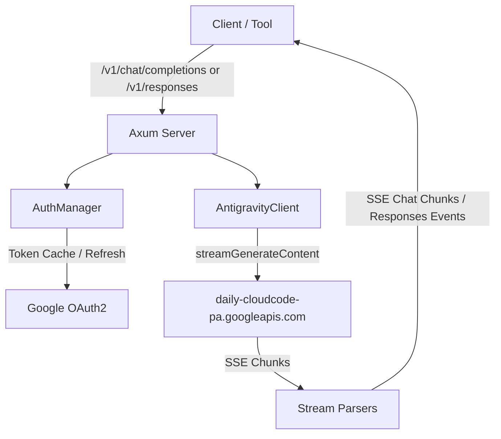

# Architecture

## Overview

`zero-g` translates standard OpenAI Chat Completions and Responses API requests into Google Cloud Code Assist (CCA) requests and decodes upstream server-sent events into OpenAI chunk streams and event notifications. It handles Google OAuth2 lifecycle management, companion project discovery, and model-specific protocol quirks transparently.

## Core Components

- **Axum HTTP Layer (`src/server/`):** Exposes `/v1/chat/completions`, `/v1/responses`, and `/v1/models` with optional Bearer authentication and CORS handling.
- **Protocol Models (`src/openai.rs`, `src/responses.rs`):** Strongly typed Serde models for Chat Completions and Responses API inputs (prompts, messages, tool outputs).
- **Auth Manager (`src/auth.rs`):** Loads credentials from `credentials.json` (local or XDG config directory); refreshes access tokens within 60 seconds of expiration.
- **Login Flow (`src/login.rs`):** Runs the local loopback OAuth listener (`51121`), exchanges authorization codes, and provisions the Cloud Code Assist project via `loadCodeAssist` and `onboardUser`.
- **Wire Translator (`src/antigravity/`):** Translates message roles, formats system instructions into `role: "user"` parts, merges multi-turn function responses, and injects Antigravity request envelopes.
- **Stream Parsers (`src/server/chat.rs`, `src/server/responses.rs`):** Decodes upstream CCA chunks and emits OpenAI chat completion chunks or Responses API lifecycle events.
## Invariants & Guarantees

- **Token Freshness:** Any request dispatched with a token expiring within 60 seconds triggers a refresh before the upstream connection opens.
- **Failover Delivery:** Requests attempt `daily-cloudcode-pa.googleapis.com` first and fail over to `daily-cloudcode-pa.sandbox.googleapis.com` on transient server errors.
- **Thought Signature Bypass:** Replayed assistant tool calls carry `thoughtSignature: "skip_thought_signature_validator"` to prevent Gemini 3 validation failures.
- **Contiguous Tool Turns:** Consecutive tool results merge into a single contiguous `role: "user"` turn as required by Cloud Code Assist.
- **Claude Wire Compliance:** Claude requests enforce `functionCallingConfig.mode: "VALIDATED"`, inject `anthropic-beta: interleaved-thinking-2025-05-14`, and cap output tokens at 64,000.
