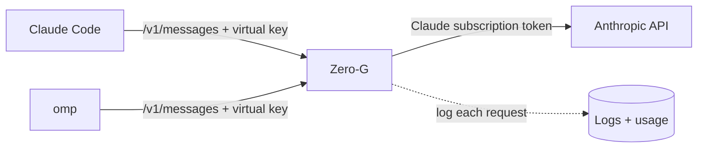

# Claude Code and omp through Zero-G

Point Claude Code or omp at Zero-G instead of Anthropic. Zero-G forwards each request to Anthropic with your stored Claude subscription login, and records it so you can see usage and logs in one place.



Zero-G does not rewrite these requests. It checks the virtual key, swaps in the Claude token, forwards the body unchanged, and logs the exchange. The client must send its own Claude Code identity, which Claude Code and omp both do. Clients that use the OpenAI format are not supported for Claude. Anthropic-format clients that do not send Claude Code's identity may be rejected by Anthropic.

## 1. Connect your Claude account

1. Open the dashboard and go to **Models → Providers**.
2. On the **Claude Code** card, start the login. Open the link, approve access, and paste the returned code back into Zero-G.
3. Several accounts can be connected. When one is rate limited or refused, Zero-G falls back to another (see [Credential Pool & Failover Logic](configuration.md#credential-pool--failover-logic)).

## 2. Create a virtual key

A virtual key is the password your tools use to talk to Zero-G. It is separate from your Claude login. Tools send it as `x-api-key` or `Authorization: Bearer`; its limits are described under [Virtual Keys & Security](configuration.md#virtual-keys--security).

1. Go to **Virtual keys** and create a key.
2. Restrict it to the `claude` provider (recommended), and optionally to specific models or an expiry date.
3. Copy the key now. It cannot be shown again.

Use one key per tool or machine (for example `claude-code-laptop` and `omp-desktop`). The logs can be filtered by key, so separate keys give you separate usage numbers.

## 3. Configure the client

Use the Zero-G address without a `/v1` suffix. Examples below use `http://127.0.0.1:8080`; use your public HTTPS address for a remote server.

### Claude Code

Do not sign in to Claude Code itself. Set these in the shell that launches it:

```bash
export ANTHROPIC_BASE_URL=http://127.0.0.1:8080
export ANTHROPIC_AUTH_TOKEN="<virtual key>"
claude
```

### omp

Edit `~/.omp/agent/models.yml`. Overriding the built-in `anthropic` provider keeps omp's normal model names and sends everything through Zero-G:

```yaml
providers:
  anthropic:
    baseUrl: http://127.0.0.1:8080 # no /v1 suffix
    apiKey: ZERO_G_TOKEN # name of an environment variable holding the virtual key
    auth: oauth
```

Then export the key in the shell that launches omp:

```bash
export ZERO_G_TOKEN="<virtual key>"
```

A provider configured this way takes priority over any Claude login stored in omp. Delete the block to go back to omp's own login.

Run `omp models refresh` to check the connection. The `anthropic` list should show Claude models only.

## 4. Check that it works

Send a short prompt, then open **LLM Logs** in the dashboard. You should see a new row with the model, status, latency and token count.

From the command line, a quick test with omp:

```bash
omp -p --no-session --no-tools --model anthropic/claude-haiku-4-5-20251001 "Reply with exactly one word: pong"
```

## How requests are handled

| Topic      | Behavior                                                                                                                                                  |
| ---------- | --------------------------------------------------------------------------------------------------------------------------------------------------------- |
| Endpoints  | `POST /v1/messages` and `POST /v1/messages/count_tokens`, for the `claude` provider only                                                                  |
| Model list | `GET /v1/models` with an `anthropic-version` header returns only Claude models, plain ids, in Anthropic's list shape; the OpenAI-format list omits Claude |
| Errors     | Anthropic's `{"type":"error"}` shape                                                                                                                      |

## What gets tracked

| Where                | What you see                                                                                                                      |
| -------------------- | --------------------------------------------------------------------------------------------------------------------------------- |
| **Dashboard**        | Total requests, successful requests, tokens, and average latency over a date range.                                               |
| **LLM Logs**         | One row per request: time, provider and model, status, latency, tokens. Open a row for the full prompt and response.              |
| **Filters**          | Narrow logs and charts by status, model, provider, virtual key, or provider credential (which Claude account served the request). |
| **Token counts**     | Input (including cache reads and writes) and output tokens, read from Anthropic's reply.                                          |
| **Account activity** | The provider's credential card shows each connected Claude account's plan (for example Max 5x) and its quota windows.             |

Prompts and responses are stored in full, so treat the dashboard as sensitive.

## Troubleshooting

| Symptom                                                                    | Meaning and fix                                                                                                                                    |
| -------------------------------------------------------------------------- | -------------------------------------------------------------------------------------------------------------------------------------------------- |
| `401 Invalid virtual key`                                                  | The key is wrong, revoked or expired. Create a new one under **Virtual keys**.                                                                     |
| `403 Virtual key does not permit...`                                       | The key is limited to other providers or models. Edit the key or make a new one.                                                                   |
| `404 Claude provider is not configured`                                    | Connect a Claude account under **Models → Providers**.                                                                                             |
| `429` with a `Retry-After` header                                          | Every connected Claude account is rate limited for that model. Wait for the delay, or connect another account.                                     |
| omp lists Codex or other non-Claude models                                 | Update Zero-G on the server, or limit the virtual key to the `claude` provider.                                                                    |
| Requests work but nothing shows in logs                                    | Check that the client really uses the Zero-G address, and that the log filters or date range in the dashboard are not hiding the request.          |
| `400 Claude is available only through the Anthropic /v1/messages endpoint` | An OpenAI-format client (`/v1/chat/completions` or `/v1/responses`) is calling a Claude model. Use an Anthropic client such as Claude Code or omp. |
| Model name rejected                                                        | Use plain names such as `claude-sonnet-4-6`. A `claude/` prefix is not accepted.                                                                   |

See [Gateways](gateways.md) for every endpoint Zero-G serves and [Configuration](configuration.md) for providers, virtual keys and retention.
