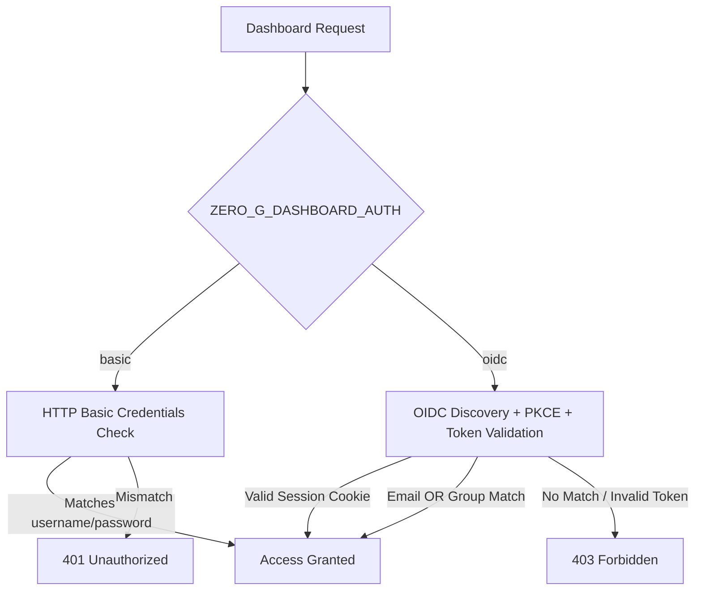

# Configuration Reference

## Environment Variables

Configure Zero-G using environment variables or a `.env` file in the working directory.

### Core Settings

| Variable                  | Default          | Required | Purpose                                                                                                                        |
| ------------------------- | ---------------- | -------- | ------------------------------------------------------------------------------------------------------------------------------ |
| `ZERO_G_ENCRYPTION_KEY`   | _None_           | **Yes**  | 32-byte Base64 secret key (`openssl rand -base64 32`) for encrypting stored credentials.                                       |
| `ZERO_G_BIND`             | `127.0.0.1:8080` | No       | Listening address and port.                                                                                                    |
| `ZERO_G_LOG_DB`           | `zero-g.db`      | No       | Path to Turso/SQLite database (container default: `/app/data/zero-g.db`).                                                      |
| `ZERO_G_DASHBOARD_AUTH`   | _None_           | **Yes**  | Authentication mode for dashboard: `basic` or `oidc`.                                                                          |
| `ZERO_G_DASHBOARD_ORIGIN` | _None_           | **Yes**  | Public dashboard URL (e.g. `https://zero-g.example.com` or `http://127.0.0.1:8080`). Used for CSRF checks and OAuth callbacks. |

### Dashboard Authentication

#### Basic Auth (`ZERO_G_DASHBOARD_AUTH=basic`)

| Variable                    | Required | Description                                |
| --------------------------- | -------- | ------------------------------------------ |
| `ZERO_G_DASHBOARD_USERNAME` | **Yes**  | Dashboard username (must not contain `:`). |
| `ZERO_G_DASHBOARD_PASSWORD` | **Yes**  | Dashboard password.                        |

#### OIDC Auth (`ZERO_G_DASHBOARD_AUTH=oidc`)

| Variable                     | Required  | Description                                                      |
| ---------------------------- | --------- | ---------------------------------------------------------------- |
| `ZERO_G_OIDC_ISSUER`         | **Yes**   | OpenID Connect issuer URL.                                       |
| `ZERO_G_OIDC_CLIENT_ID`      | **Yes**   | OIDC Client ID.                                                  |
| `ZERO_G_OIDC_CLIENT_SECRET`  | **Yes**   | OIDC Client Secret.                                              |
| `ZERO_G_OIDC_REDIRECT_URL`   | **Yes**   | Exact redirect URL (`${ZERO_G_DASHBOARD_ORIGIN}/auth/callback`). |
| `ZERO_G_OIDC_ALLOWED_EMAILS` | Optional* | Comma-separated list of allowed verified email addresses.        |
| `ZERO_G_OIDC_ALLOWED_GROUPS` | Optional* | Comma-separated list of allowed group claims (case-sensitive).   |

> **Note**: At least one of `ZERO_G_OIDC_ALLOWED_EMAILS` or `ZERO_G_OIDC_ALLOWED_GROUPS` is required. Access is granted if either matches.

---

## Providers & Authentication Methods

Manage providers under **Models → Providers** in the dashboard.
Built-in provider cards show their name without a separate type label. Custom OpenAI-compatible providers also show their type and ID.

| Provider               | Type        | ID               | Auth Mechanism       | Setup / Credentials                                                                                                                                                                                                                     |
| ---------------------- | ----------- | ---------------- | -------------------- | --------------------------------------------------------------------------------------------------------------------------------------------------------------------------------------------------------------------------------------- |
| **Google Antigravity** | Quota only  | `agy`            | None (pushed report) | Add a credential named after the Google account; quota comes from the official `agy` CLI through `scripts/agy-quota.py` (see [gateways](gateways.md)). No model routes, no sign-in.                                                     |
| **Codex**              | Translation | `codex`          | OpenAI Device Code   | Device authorization at `auth.openai.com/codex/device`.                                                                                                                                                                                 |
| **Claude Code**        | Passthrough | `claude`         | Anthropic OAuth Flow | Paste returned authorization URL/code. `/v1/messages` passes Anthropic requests through; there are no OpenAI-format routes.                                                                                                             |
| **Cursor**             | Translation | `cursor`         | OAuth browser login  | Sign in through the browser; Zero-G polls for completion.                                                                                                                                                                               |
| **OpenCode Zen**       | Passthrough | `zen`            | API Key / Keyless    | Keyless upstream supported. Balance check requires console session cookie.                                                                                                                                                              |
| **OpenCode Go**        | Passthrough | `go`             | API Key              | Subscription API key.                                                                                                                                                                                                                   |
| **OpenRouter**         | Passthrough | `openrouter`     | API Key              | Standard API key. Account credits check requires a Management Key.                                                                                                                                                                      |
| **Command Code**       | Passthrough | `commandcode`    | API Key              | Command Code API key (any plan except Go). Claude models are hidden: Command Code serves them only in Anthropic's `/messages` format.                                                                                                   |
| **Command Code Go**    | Translation | `commandcode-go` | API Key              | Same Command Code API key; works on the $1 Go plan by using the CLI's private `/alpha/generate` endpoint. Lists only Go plan models. Undocumented: it can break without notice, and Command Code may treat it as bypassing plan limits. |
| **ChatJimmy**          | Translation | `chatjimmy`      | API Key / Keyless    | Keyless upstream; uses Taalas HC1 silicon at `chatjimmy.ai`.                                                                                                                                                                            |
| **Custom OpenAI**      | Passthrough | _Custom_         | API Key / Keyless    | Configurable base URL; forwards `/v1/chat/completions` & `/v1/responses`.                                                                                                                                                               |

---

## Credential Pool & Failover Logic

- Each request tries enabled, connected credentials in weighted random order, each at most once.
- Weight 3 is picked first about three times as often as weight 1.
- An upstream 401, 403 or 429 before streaming moves on to the next credential, so actual traffic can differ from the weights.
- Keyless providers skip the pool.
- A rate-limited credential enters an in-memory cooldown and is skipped until its retry time. Cooldowns are local to each running instance and reset on restart.

---

## Virtual Keys & Security

Clients authenticate with inference endpoints via `Authorization: Bearer <virtual_key>`
or, as Anthropic clients send it, `x-api-key: <virtual_key>`.

| Feature                   | Details                                                                                                                                                                                                                                                  |
| ------------------------- | -------------------------------------------------------------------------------------------------------------------------------------------------------------------------------------------------------------------------------------------------------- |
| **Model Namespacing**     | OpenAI-format requests use `<provider-id>/<upstream-model-id>` (e.g. `codex/gpt-6-sol`); Anthropic `/v1/messages` uses plain names.                                                                                                                      |
| **Scoped Permissions**    | Virtual keys can be restricted to specific provider IDs, models, or expiration dates.                                                                                                                                                                    |
| **Session Identity**      | `session_id`, `x-session-id`, or `x-opencode-session` derives an upstream session identity scoped to the virtual key and provider; it does not pin a credential.                                                                                         |
| **Storage**               | Virtual-key hashes are stored in the database. Keys cannot be read back once generated.                                                                                                                                                                  |
| **Exporting Credentials** | `bun run scripts/export-credentials.ts ~/credentials.json` writes decrypted provider secrets to a new file. Set `ZERO_G_ENCRYPTION_KEY` and, for a non-default database, `ZERO_G_LOG_DB`; protect the output. Virtual keys cannot be recovered this way. |

---

## Request & Quota Limits

| Limit                              | Value                     | Action on Breach                                                                                                                                                 |
| ---------------------------------- | ------------------------- | ---------------------------------------------------------------------------------------------------------------------------------------------------------------- |
| **Unified inference request size** | 20,000,000 bytes (~20 MB) | HTTP 413 Payload Too Large                                                                                                                                       |
| **Response Log Truncation**        | 100 MiB                   | Logged body truncated; client stream unimpacted                                                                                                                  |
| **Max Pending OIDC Logins**        | 1,024 concurrent          | HTTP 503 Service Unavailable                                                                                                                                     |
| **Default Log Retention**          | 90 days (range: 1–36,500) | Log rows, charts and token totals pruned at startup and hourly; setting changes apply at the next cleanup                                                        |
| **Default Body Retention**         | 7 days (range: 1–36,500)  | Stored prompts and responses pruned at startup and hourly; the log row stays and its detail view reports the bodies as expired. Never longer than log retention. |
