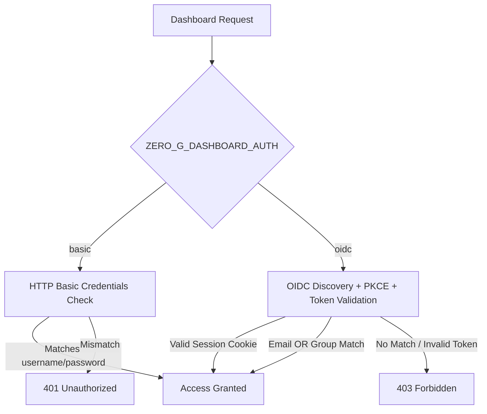
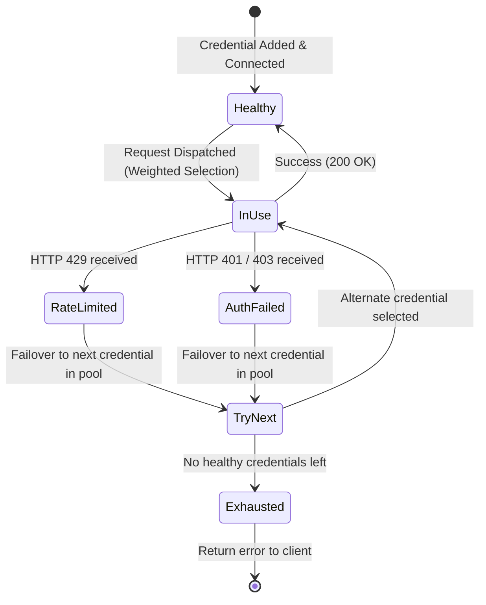

# Configuration Reference

## Environment Variables

Configure Zero-G using environment variables or a `.env` file in the working directory.

### Core Settings

| Variable | Default | Required | Purpose |
|---|---|---|---|
| `ZERO_G_ENCRYPTION_KEY` | _None_ | **Yes** | 32-byte Base64 secret key (`openssl rand -base64 32`) for encrypting stored credentials. |
| `ZERO_G_BIND` | `127.0.0.1:8080` | No | Listening address and port. |
| `ZERO_G_LOG_DB` | `zero-g.db` | No | Path to Turso/SQLite database (container default: `/app/data/zero-g.db`). |
| `ZERO_G_DASHBOARD_AUTH` | _None_ | **Yes** | Authentication mode for dashboard: `basic` or `oidc`. |
| `ZERO_G_DASHBOARD_ORIGIN` | _None_ | **Yes** | Public dashboard URL (e.g. `https://zero-g.example.com` or `http://127.0.0.1:8080`). Used for CSRF checks and OAuth callbacks. |

### Dashboard Authentication

#### Basic Auth (`ZERO_G_DASHBOARD_AUTH=basic`)

| Variable | Required | Description |
|---|---|---|
| `ZERO_G_DASHBOARD_USERNAME` | **Yes** | Dashboard username (must not contain `:`). |
| `ZERO_G_DASHBOARD_PASSWORD` | **Yes** | Dashboard password. |

#### OIDC Auth (`ZERO_G_DASHBOARD_AUTH=oidc`)

| Variable | Required | Description |
|---|---|---|
| `ZERO_G_OIDC_ISSUER` | **Yes** | OpenID Connect discovery URL. |
| `ZERO_G_OIDC_CLIENT_ID` | **Yes** | OIDC Client ID. |
| `ZERO_G_OIDC_CLIENT_SECRET` | **Yes** | OIDC Client Secret. |
| `ZERO_G_OIDC_REDIRECT_URL` | **Yes** | Exact redirect URL (`${ZERO_G_DASHBOARD_ORIGIN}/auth/callback`). |
| `ZERO_G_OIDC_ALLOWED_EMAILS` | Optional* | Comma-separated list of allowed verified email addresses. |
| `ZERO_G_OIDC_ALLOWED_GROUPS` | Optional* | Comma-separated list of allowed group claims (case-sensitive). |

> **Note**: At least one of `ZERO_G_OIDC_ALLOWED_EMAILS` or `ZERO_G_OIDC_ALLOWED_GROUPS` is required. Access is granted if either matches.

---

## Providers & Authentication Methods

Manage providers under **Models → Providers** in the dashboard.
Built-in provider cards show their name without a separate type label. Custom OpenAI-compatible providers also show their type and ID.

| Provider | Type | ID | Auth Mechanism | Setup / Credentials |
|---|---|---|---|---|
| **Antigravity** | Translation | `agy` | Google OAuth (OAuth Device / Web) | Google sign-in; supports remote callback URL paste. |
| **Codex** | Translation | `codex` | OpenAI Device Code | Device authorization code on `auth0.openai.com`. |
| **Claude Code** | Translation | `claude` | Anthropic OAuth Flow | Paste returned authorization URL/code. |
| **Cursor** | Translation | `cursor` | Built-in Client | Undocumented agent protocol. |
| **Grok** | Translation | `grok` | xAI Device Flow | OAuth at `api.x.ai`. |
| **Grok Build** | Translation | `grok-build` | CLI Proxy | Device code authorization via Grok CLI proxy. |
| **OpenCode Zen** | Passthrough | `zen` | API Key / Keyless | Keyless upstream supported. Balance check requires console session cookie. |
| **OpenCode Go** | Passthrough | `go` | API Key | Subscription API key. |
| **OpenRouter** | Passthrough | `openrouter` | API Key | Standard API key. Account credits check requires a Management Key. |
| **ChatJimmy** | Translation | `chatjimmy` | API Key / Keyless | Keyless upstream; uses Taalas HC1 silicon at `chatjimmy.ai`. |
| **Custom OpenAI** | Passthrough | _Custom_ | API Key / Keyless | Configurable base URL; forwards `/v1/chat/completions` & `/v1/responses`. |

---

## Credential Pool & Failover Logic

- **Weighted Routing**: Higher weight values receive proportionally more requests (weight 3 = ~3x traffic of weight 1).
- **Failover Window**: Zero-G only fails over to alternative credentials if the upstream error occurs **before** streaming chunks are emitted.

---

## Virtual Keys & Security

Clients authenticate with inference endpoints via `Authorization: Bearer <virtual_key>`.

| Feature | Details |
|---|---|
| **Model Namespacing** | Requests use `<provider-id>/<upstream-model-id>` (e.g. `agy/claude-sonnet-4`). |
| **Scoped Permissions** | Virtual keys can be restricted to specific provider IDs, models, or expiration dates. |
| **Session Affinity** | Forward headers (`session_id`, `x-session-id`, `x-opencode-session`) to retain session continuity. |
| **Storage & Export** | Hashes stored in DB. Keys cannot be read back once generated. |
| **Exporting Credentials** | Use CLI script `bun run scripts/export-credentials.ts ~/credentials.json` (requires zero-g stopped). |

---

## Request & Quota Limits

| Limit | Value | Action on Breach |
|---|---|---|
| **Max Request Size** | 20,000,000 bytes (~20 MB) | HTTP 413 Payload Too Large |
| **Response Log Truncation** | 256 KiB | Logged body truncated; client stream unimpacted |
| **Max Pending OIDC Logins** | 1,024 concurrent | HTTP 503 Service Unavailable |
| **Default Log Retention** | 30 days (range: 1–36,500) | Old records pruned automatically |
