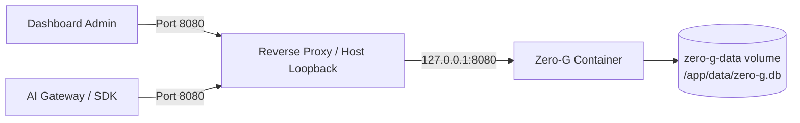
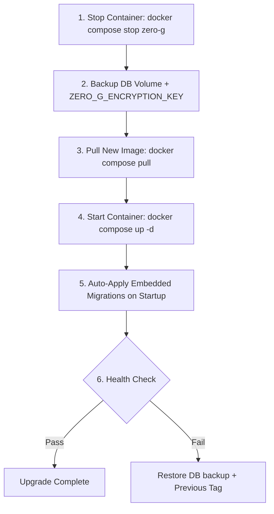

# Deployment & Operations

Zero-G is packaged as a lightweight Linux container image (`ghcr.io/delnegend/zero-g`) with an embedded SQLite/Turso database and frontend bundle.

---

## Quick Deploy (Docker Compose)



### 1. Configuration Setup

Create an environment file:

```bash
# Generate encryption key
echo "ZERO_G_ENCRYPTION_KEY=$(openssl rand -base64 32)" > .env

# Set basic credentials and origins
cat <<EOF >> .env
ZERO_G_DASHBOARD_AUTH=basic
ZERO_G_DASHBOARD_USERNAME=admin
ZERO_G_DASHBOARD_PASSWORD=$(openssl rand -hex 16)
ZERO_G_DASHBOARD_ORIGIN=http://127.0.0.1:8080
EOF
chmod 600 .env
```

### 2. Docker Compose File

Save as `compose.yml`:

```yaml
services:
  zero-g:
    image: ghcr.io/delnegend/zero-g:latest
    container_name: zero-g
    restart: unless-stopped
    ports:
      - "127.0.0.1:8080:8080"
    environment:
      - ZERO_G_BIND=0.0.0.0:8080
      - ZERO_G_LOG_DB=/app/data/zero-g.db
    env_file:
      - .env
    volumes:
      - zero-g-data:/app/data

volumes:
  zero-g-data:
```

### 3. Startup & Health Verification

| Step | Command | Expected Output |
|---|---|---|
| **Start Service** | `docker compose up -d` | Container starts in background |
| **Check Health** | `curl -f http://127.0.0.1:8080/health` | `HTTP 200 OK` |
| **Inspect Logs** | `docker compose logs -f zero-g` | Migration status and listening banner |

---

## Upgrade & Migration Workflow

Migrations are automatically applied on startup by the embedded Toasty ORM engine.



### Upgrade Checklist

| Task | Action | Command |
|---|---|---|
| **1. Stop container** | Prevent write operations | `docker compose stop zero-g` |
| **2. Backup database** | Copy SQLite database and journal | `docker run --rm -v zero-g_zero-g-data:/data -v $(pwd):/backup alpine cp /data/zero-g.db /backup/` |
| **3. Backup key** | Confirm `.env` key is preserved | `cat .env \| grep ZERO_G_ENCRYPTION_KEY` |
| **4. Pull & Restart** | Run new version | `docker compose pull && docker compose up -d` |
| **5. Verify status** | Confirm health and auth | `curl -f http://127.0.0.1:8080/health` |

---

## Backup & Recovery

| Item | What to Backup | Why it's Critical |
|---|---|---|
| **Database File** | `/app/data/zero-g.db` (+ any `-wal` / `-shm` sidecars) | Contains credentials, provider definitions, virtual keys, and request telemetry. |
| **Encryption Key** | `ZERO_G_ENCRYPTION_KEY` | Without this key, existing stored credentials and secrets **cannot be decrypted**. |
| **Dashboard Password / OIDC Config** | `.env` file | Needed for dashboard administrative access. |
