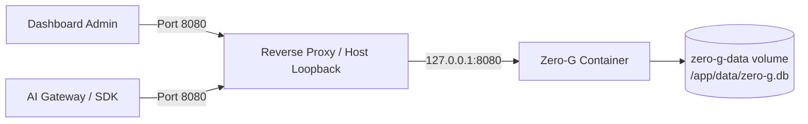

# Deployment & Operations

Zero-G is packaged as a lightweight Linux container image (`ghcr.io/delnegend/zero-g`) with an embedded SQLite/Turso database and frontend bundle.

---

## Quick Deploy (Docker Compose)



### 1. Configuration Setup

Create an environment file:

```bash
# Generate encryption key
echo "ZERO_G_ENCRYPTION_KEY=$(openssl rand -base64 32)" > .env

# Set basic credentials and origins
cat <<EOF >> .env
ZERO_G_DASHBOARD_AUTH=basic
ZERO_G_DASHBOARD_USERNAME=admin
ZERO_G_DASHBOARD_PASSWORD=$(openssl rand -hex 16)
ZERO_G_DASHBOARD_ORIGIN=http://127.0.0.1:8080
EOF
chmod 600 .env
```

### 2. Docker Compose File

Save as `compose.yml`:

```yaml
services:
  zero-g:
    image: ghcr.io/delnegend/zero-g:latest
    container_name: zero-g
    restart: unless-stopped
    ports:
      - "127.0.0.1:8080:8080"
    environment:
      - ZERO_G_BIND=0.0.0.0:8080
      - ZERO_G_LOG_DB=/app/data/zero-g.db
    env_file:
      - .env
    volumes:
      - zero-g-data:/app/data

volumes:
  zero-g-data:
    name: zero-g-data
```

### 3. Startup & Health Verification

| Step              | Command                                | Expected Output                             |
| ----------------- | -------------------------------------- | ------------------------------------------- |
| **Start Service** | `docker compose up -d`                 | Container starts in background              |
| **Check Health**  | `curl -f http://127.0.0.1:8080/health` | Successful exit; the response body is empty |
| **Inspect Logs**  | `docker compose logs -f zero-g`        | Listening address and inference route       |

---

## Upgrade & Migration Workflow

Migrations are applied automatically on startup by the embedded Toasty ORM engine.

### Upgrade Checklist

| Task                      | Action                                                                                                                                                                                          | Command                                                                                                             |
| ------------------------- | ----------------------------------------------------------------------------------------------------------------------------------------------------------------------------------------------- | ------------------------------------------------------------------------------------------------------------------- |
| **1. Stop container**     | Prevent write operations                                                                                                                                                                        | `docker compose stop zero-g`                                                                                        |
| **2. Backup database**    | Archive the stopped container's `zero-g.db` and any `-wal` / `-shm` sidecars to a protected location. It holds credentials, provider definitions, virtual keys and request telemetry.           | `docker run --rm -v zero-g-data:/data:ro -v "$(pwd)":/backup alpine tar -C /data -czf /backup/zero-g-data.tar.gz .` |
| **3. Backup key**         | Securely back up `.env` separately from the database; do not print the key. Without `ZERO_G_ENCRYPTION_KEY`, stored credentials **cannot be decrypted**. `.env` also holds the dashboard login. | Store an encrypted copy in your secret manager.                                                                     |
| **4. Pull & Restart**     | Run new version; migrations apply on startup                                                                                                                                                    | `docker compose pull && docker compose up -d`                                                                       |
| **5. Verify status**      | Confirm the server responds                                                                                                                                                                     | `curl -f http://127.0.0.1:8080/health`                                                                              |
| **If verification fails** | Restore the database backup and start the previous image tag                                                                                                                                    | Restore `zero-g-data.tar.gz` into the volume, then pin the earlier tag in `compose.yml`.                            |

---

## Reclaiming disk space

Pruning frees pages that new logs reuse, but the file never shrinks. Turso has
no `VACUUM`, so shrink it offline after a large cleanup:

1. `docker compose stop zero-g`
2. Back up the volume (Upgrade Checklist step 2).
3. `docker run --rm -v zero-g-data:/data alpine sh -c 'apk add -q sqlite && sqlite3 /data/zero-g.db VACUUM'`
4. `docker compose start zero-g`

`VACUUM` needs free disk space roughly equal to the database size while it runs.
