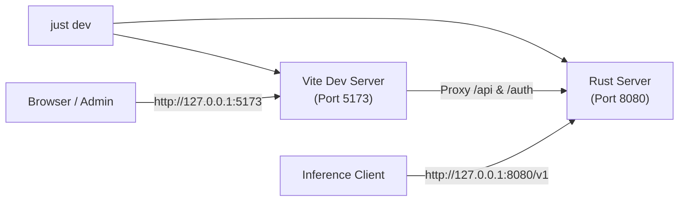
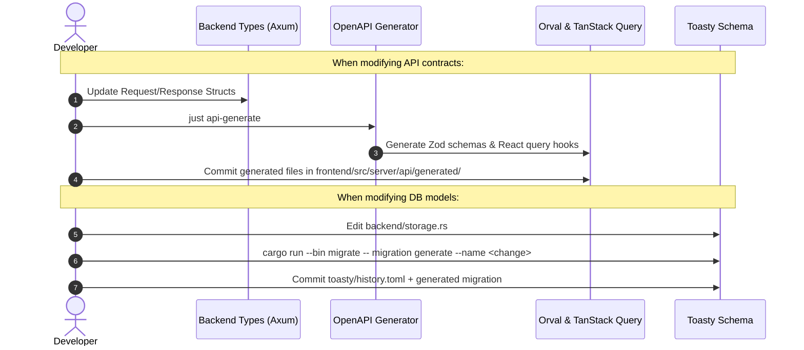

# Development Guide

## Toolchain & Prerequisites

| Requirement | Version | Purpose |
|---|---|---|
| **Rust** | 1.95+ stable | Backend engine, migrations, Axum server (`rustc`, `cargo`, `clippy`). |
| **Bun** | 1.4.4 | Frontend package manager and task execution. |
| **just** | Latest | Task runner for builds, tests, checks, and code generation. |

---

## Quick Start & Daily Workflow



### Common Commands

| Command | Action | Notes |
|---|---|---|
| `just dev` | Start backend & frontend with HMR | Vite proxies `/api` to backend. Accessible at `http://127.0.0.1:5173`. |
| `just check` | Single CI gate check | Formats, lints, frontend tests, Rust test suite, OpenAPI checks. |
| `just test` | Run all test suites | Unit and integration tests for Rust and frontend. |
| `just fmt` | Format code | Runs `cargo fmt` and `bun run prettier/biome`. |
| `just build` | Compile release binary | Builds frontend assets and embeds them into `target/release/zero-g`. |
| `just seed` | Populate mock data | Appends 140 synthetic requests and test keys to development DB. |
| `just api-generate` | Sync frontend API clients | Regenerates Orval clients from OpenAPI spec. |

---

## Architecture & Code Map

```
zero-g/
├── backend/
│   ├── database.rs          # Turso / SQLite connection pool
│   ├── storage.rs           # Toasty models & schemas
│   ├── server/              # Axum HTTP handlers & dashboard APIs
│   └── provider/            # LLM provider translation & passthrough engines
│       ├── antigravity/     # Google Cloud Code Assist integration
│       ├── codex/           # ChatGPT backend integration
│       ├── claude/          # Anthropic OAuth integration
│       └── common/          # Provider trait & credential failover
├── frontend/
│   ├── src/
│   │   ├── routes/          # TanStack Router page layouts
│   │   ├── components/      # Reusable UI widgets (shadcn, charts)
│   │   └── server/api/      # Orval-generated query hooks & schemas
└── toasty/                  # Database migrations
```

---

## Contract & Schema Lifecycle



---

## Code Quality Standards

| Area | Rule / Standard | Enforcement |
|---|---|---|
| **Rust Lints** | [Namtao strict Clippy](https://www.namtao.com/rust/#strict-lints) | Pedantic, nursery, missing docs on private items check (`just check`). |
| **Frontend Compiler** | Oxc React Compiler | Automatic memoization of eligible React components. |
| **Audits & Deps** | OSV Scanner | `osv-scanner.toml` contains policy and temporary waivers. |
| **Migrations** | Zero uncommitted schema changes | Startup applies only committed Toasty migrations. |
