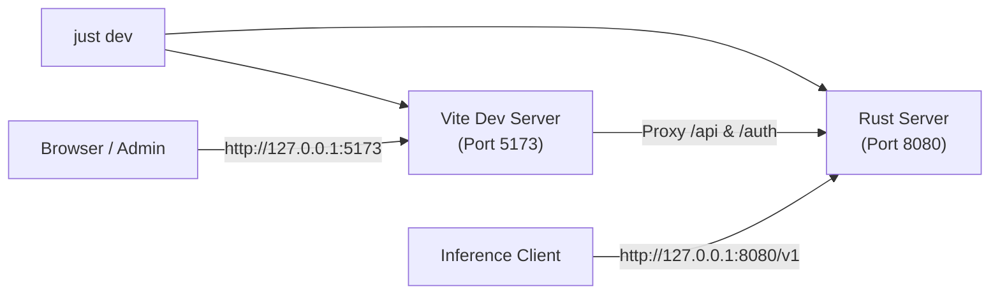
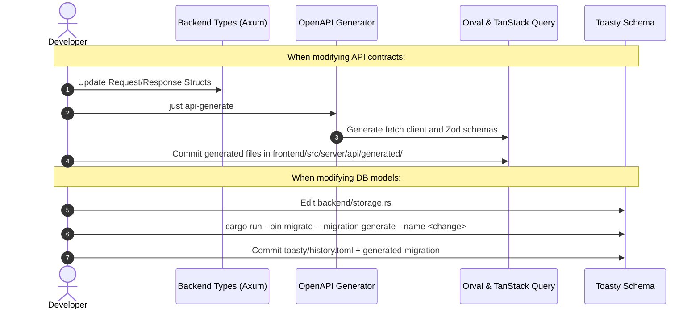

# Development Guide

## Toolchain & Prerequisites

| Requirement | Version | Purpose |
|---|---|---|
| **Rust** | 1.95+ stable | Backend engine, migrations, Axum server (`rustc`, `cargo`, `clippy`). |
| **Bun** | 1.4.4 | Frontend package manager and task execution. |
| **just** | Latest | Task runner for builds, tests, checks, and code generation. |

Copy `.env.example` to `.env` and set `ZERO_G_ENCRYPTION_KEY` and the dashboard
authentication settings before starting the backend.

---

## Quick Start & Daily Workflow



### Common Commands

| Command | Action | Notes |
|---|---|---|
| `just dev` | Start backend and frontend | Builds the frontend first, then runs the backend with `cargo run` and Vite with frontend HMR. Vite proxies `/api` to the backend at `http://127.0.0.1:5173`. |
| `just check` | Single CI gate check | Formats, lints, frontend tests, Rust test suite, OpenAPI checks. |
| `just test` | Run all test suites | Unit and integration tests for Rust and frontend. |
| `just lint` | Lint and format code | Runs Oxlint, `cargo fmt` and `bun fmt`. |
| `just build` | Compile release binary | Builds frontend assets and embeds them into `target/release/zero-g`. |
| `just seed` | Populate mock data | Adds example providers, keys and logs to an initialized development database; stop the server first. |
| `just api-generate` | Sync frontend API clients | Regenerates Orval clients from OpenAPI spec. |

---

## Architecture & Code Map

```
zero-g/
├── backend/
│   ├── database.rs          # Turso / SQLite connection pool
│   ├── storage.rs           # Toasty models & schemas
│   ├── server/              # Axum handlers, observability, and dashboard APIs
│   │   └── observability/   # Request storage, retention, aggregation, and tests
│   └── provider/            # LLM provider translation & passthrough engines
│       ├── antigravity/     # Model routing, payload conversion, and OAuth
│       ├── codex/           # ChatGPT payload and streaming translation
│       ├── claude/          # Anthropic OAuth integration
│       └── common/          # Provider traits, retry helpers, and shared SSE framing
├── frontend/
│   ├── src/
│   │   ├── routes/          # TanStack Router page layouts
│   │   ├── components/      # Reusable UI widgets (shadcn, charts)
│   │   ├── routes/__root.tsx # Shared page layout, title, and actions
│   │   ├── components/KeyForm.tsx # Virtual key form and expiration controls
│   │   ├── *Interactions.cases.tsx # Feature-grouped interaction tests
│   │   └── server/api/      # Generated fetch client and Zod schemas; separate query wrappers
└── toasty/                  # Database migrations
```

Related Rust implementation and test modules live together in named directories
with `mod.rs` as their entry point.


---

## Contract & Schema Lifecycle

Public dashboard and inference operations are documented in the OpenAPI
contract. Provider-specific inference routes are internal dispatch targets, not
additional public endpoints. Dashboard assets and the client-side fallback are
served separately; the root dashboard entry is documented as `GET /`.




---

## Code Quality Standards

| Area | Rule / Standard | Enforcement |
|---|---|---|
| **Rust Lints** | [Namtao strict Clippy](https://www.namtao.com/rust/#strict-lints) | Pedantic, nursery, missing docs on private items check (`just check`). |
| **Frontend Compiler** | Oxc React Compiler | Automatic memoization of eligible React components. |
| **Tailwind classes** | Canonical names and spacing-scale suggestions | Oxlint warns when a hardcoded length matches a theme token; suggestions can change sizing if the theme or root font size changes. |
| **Audits & Deps** | OSV Scanner | `osv-scanner.toml` contains policy and temporary waivers. |
| **Migrations** | Zero uncommitted schema changes | Startup applies only committed Toasty migrations. |
