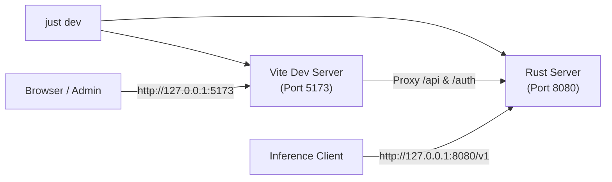
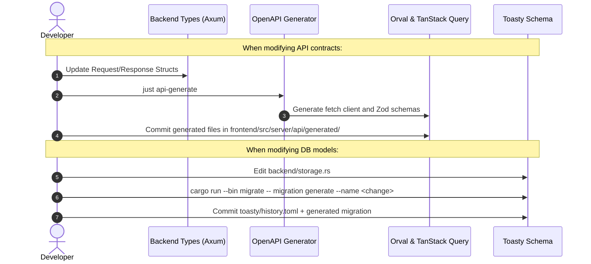

# Development Guide

## Toolchain & Prerequisites

| Requirement | Version      | Purpose                                                               |
| ----------- | ------------ | --------------------------------------------------------------------- |
| **Rust**    | 1.95+ stable | Backend engine, migrations, Axum server (`rustc`, `cargo`, `clippy`). |
| **Bun**     | 1.4.4        | Frontend package manager and task execution.                          |
| **just**    | Latest       | Task runner for builds, tests, checks, and code generation.           |

Copy `.env.example` to `.env`; set `ZERO_G_ENCRYPTION_KEY` and dashboard auth before starting.

---

## Quick Start & Daily Workflow



### Common Commands

| Command             | Action                     | Notes                                                                                                                                                   |
| ------------------- | -------------------------- | ------------------------------------------------------------------------------------------------------------------------------------------------------- |
| `just dev`          | Start backend and frontend | Builds the frontend, then runs the backend (`cargo run`) and Vite with HMR at `http://127.0.0.1:5173`, which proxies `/api` and `/auth` to the backend. |
| `just check`        | Single CI gate check       | Formats, lints, frontend tests, Rust test suite, OpenAPI checks.                                                                                        |
| `just test`         | Run all test suites        | Unit and integration tests for Rust and frontend.                                                                                                       |
| `just lint`         | Lint and format code       | Runs Oxlint (any warning fails), `cargo fmt` and `bun fmt`.                                                                                             |
| `just build`        | Compile release binary     | Builds frontend assets and embeds them into `target/release/zero-g`.                                                                                    |
| `just seed`         | Populate mock data         | Adds example providers, keys and logs to an initialized development database; stop the server first.                                                    |
| `just api-generate` | Sync frontend API clients  | Regenerates Orval clients from OpenAPI spec.                                                                                                            |

---

## Architecture & Code Map

```
zero-g/
├── backend/
│   ├── database.rs          # Turso / SQLite connection
│   ├── storage.rs           # Toasty models
│   ├── server/              # Axum handlers and dashboard APIs
│   │   └── observability/   # Request capture, retention, dashboard, logs
│   └── provider/            # One directory per provider
│       └── common/          # Shared traits, retry, SSE framing
├── frontend/src/
│   ├── routes/              # TanStack Router pages (__root.tsx: shared layout)
│   ├── components/          # UI widgets, charts, log views and their tests
│   ├── *Interactions.cases.tsx  # Feature-grouped interaction tests
│   └── server/api/          # Generated client and Zod schemas
└── toasty/                  # Database migrations
```

- Rust modules with tests live in named directories with `mod.rs` as entry.
- OAuth providers keep their stored credential fields private in their own `auth.rs`.

### Observability

| Endpoint             | Handler        | Serves                                                                                |
| -------------------- | -------------- | ------------------------------------------------------------------------------------- |
| `GET /api/dashboard` | `dashboard.rs` | Totals and charts for the whole selected range                                        |
| `GET /api/logs`      | `logs.rs`      | One page of log metadata: `page` (from 1), `limit` 1-200 (default 20), matching total |
| `GET /api/logs/{id}` | `logs.rs`      | Captured request and response bodies                                                  |

All three need dashboard auth and share one filter (`filter.rs`): range, dimensions, statuses, choices.

| Topic        | Rule                                                                                                                                 |
| ------------ | ------------------------------------------------------------------------------------------------------------------------------------ |
| Search       | Provider, model or path text (ASCII case-insensitive); a whole number also matches log ID, status or timestamp                       |
| Token totals | Missing counts stay unreported, never zero, so a provider total can be partial                                                       |
| Charts       | Span the whole range, including periods with no requests                                                                             |
| Storage      | Bodies live in `request_log_payloads`, zstd level 3 (~2.7x smaller), apart from `request_logs`; list and chart scans never read them |
| Capture      | Log row, bodies and filter snapshots commit in one transaction; bodies capped at 100 MiB, so the readable view can be incomplete     |
| Retention    | Bodies after `body_retention_days` (7), rows after `log_retention_days` (90)                                                         |
| Queries      | Built with Toasty; no hand-written SQL                                                                                               |

---

## Contract & Schema Lifecycle

- The OpenAPI contract covers public dashboard and inference operations, plus `GET /` for the dashboard.
- Provider-specific inference routes are internal dispatch targets, not public endpoints.



---

## Code Quality Standards

| Area                  | Rule / Standard                                                   | Enforcement                                                                                                                                                                                                                                         |
| --------------------- | ----------------------------------------------------------------- | --------------------------------------------------------------------------------------------------------------------------------------------------------------------------------------------------------------------------------------------------- |
| **Rust Lints**        | [Namtao strict Clippy](https://www.namtao.com/rust/#strict-lints) | Pedantic, nursery, missing docs on private items check (`just check`).                                                                                                                                                                              |
| **Frontend Compiler** | Oxc React Compiler                                                | Automatic memoization of eligible React components.                                                                                                                                                                                                 |
| **Tailwind classes**  | Matches the Tailwind CSS editor diagnostics                       | Oxlint flags conflicting, unknown, deprecated and non-canonical classes, variant order, and hardcoded lengths that match a theme token; any finding fails `just check`. Token suggestions can change sizing if the theme or root font size changes. |
| **Audits & Deps**     | OSV Scanner                                                       | `osv-scanner.toml` contains policy and temporary waivers.                                                                                                                                                                                           |
| **Migrations**        | Zero uncommitted schema changes                                   | Startup applies only committed Toasty migrations.                                                                                                                                                                                                   |
