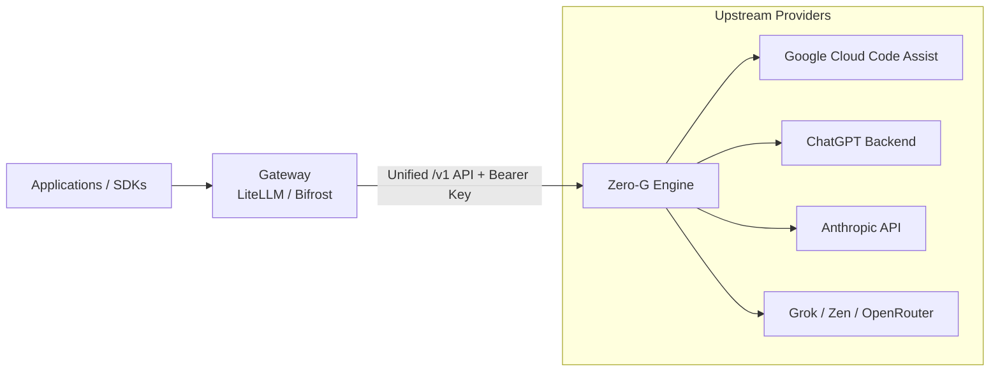

# Gateway Integration

Zero-G is built to sit behind OpenAI-compatible routing gateways (such as **LiteLLM** or **Bifrost**). 

The gateway handles rate-limiting, organizational budgets, and user routing. Zero-G handles provider authentication, token refreshes, credential pooling, and protocol translation.



---

## Gateway Comparison & Setup

| Gateway | Config Format | Base URL Pattern | Key Feature Support |
|---|---|---|---|
| **LiteLLM** | YAML (`model_list`) | `http://zero-g:8080/v1` | Per-model routing, load balancing, cost tracking. |
| **Bifrost** | JSON (`providers`) | `http://zero-g:8080` (Bifrost appends `/v1`) | Direct custom OpenAI provider pass-through. |

---

## Configuration Examples

### LiteLLM Configuration

Add deployments to `config.yaml`:

```yaml
model_list:
  - model_name: agy-claude
    litellm_params:
      model: openai/agy/claude-sonnet-5-5-medium
      api_base: http://zero-g:8080/v1
      api_key: os.environ/ZERO_G_VIRTUAL_KEY

  - model_name: codex-gpt5
    litellm_params:
      model: openai/codex/gpt-5.3-codex
      api_base: http://zero-g:8080/v1
      api_key: os.environ/ZERO_G_VIRTUAL_KEY

  - model_name: zen-beam
    litellm_params:
      model: openai/zen/beam-free
      api_base: http://zero-g:8080/v1
      api_key: os.environ/ZERO_G_VIRTUAL_KEY
```

### Bifrost Configuration

Configure a custom provider in `bifrost.json`:

```json
{
  "providers": {
    "zero-g": {
      "keys": [
        { "name": "zero-g", "value": "<ZERO_G_VIRTUAL_KEY>", "models": ["*"] }
      ],
      "network_config": { 
        "base_url": "http://zero-g:8080" 
      },
      "custom_provider_config": {
        "base_provider_type": "openai",
        "allowed_requests": {
          "list_models": true,
          "chat_completion": true,
          "chat_completion_stream": true,
          "responses": true,
          "responses_stream": true
        }
      }
    }
  }
}
```

---

## Endpoint Compatibility Matrix

| Endpoint | Supported Providers | Notes |
|---|---|---|
| `/v1/chat/completions` | All providers | OpenAI chat format with streaming chunk translation. |
| `/v1/responses` | All providers | Responses API format with lifecycle event streaming. |
| `/v1/models` | All providers | Aggregated discovery returning `<provider-id>/<model-id>`. |
| `/v1/decisions` | `openrouter` only | Native OpenRouter multimodal Decisions API. |

### OpenRouter Decisions API Example

```bash
curl http://127.0.0.1:8080/v1/decisions \
  -H "Authorization: Bearer $ZERO_G_VIRTUAL_KEY" \
  -H "Content-Type: application/json" \
  -d '{
    "model": "openrouter/cloudflare/clef",
    "state": "A red square",
    "questions": {
      "is_red": {
        "type": "noul",
        "instructions": "Is it red?"
      }
    }
  }'
```

---

## Error Handling & Wire Invariants

| Behavior | Provider Scope | Upstream Handling |
|---|---|---|
| **Usage Chunks** | Codex, Cursor, Antigravity | Emits final usage chunk when `stream_options.include_usage: true` is requested. |
| **Stream Termination** | Codex, Antigravity | Emits `data: [DONE]` on clean close. Interrupted streams yield an error event instead of a silent finish. |
| **Unsupported Limits** | Codex | Rejects `max_tokens` and `max_completion_tokens` with HTTP 400 (does not silently ignore). |
| **Strict Wire Options** | Translated Providers | Rejects unsupported options (e.g. unknown structured formats, stop sequences, unsupported choice counts) with clear errors instead of dropping them silently. |
