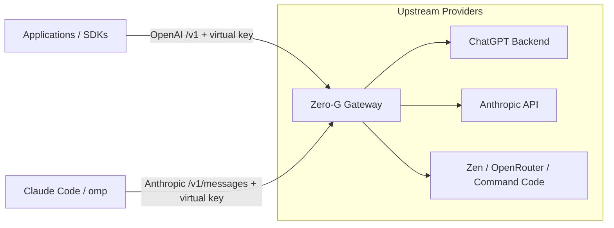

# Gateway

Zero-G is the gateway: apps and coding agents connect directly with a virtual key.

- OpenAI-compatible `/v1` API for every model-serving provider except Claude; native Anthropic `/v1/messages` for Claude clients.
- Virtual keys with provider and model allowlists, request logs, token usage and the dashboard.
- Provider sign-in, token refresh, credential pooling with failover, and protocol translation.



---

## Endpoint Compatibility Matrix

| Endpoint                                    | Supported Providers                   | Notes                                                                                                                                                         |
| ------------------------------------------- | ------------------------------------- | ------------------------------------------------------------------------------------------------------------------------------------------------------------- |
| `/v1/chat/completions`                      | All except `claude`, `agy`            | OpenAI chat format; translated providers convert streaming chunks, while passthrough providers forward upstream responses.                                    |
| `/v1/responses`                             | All except ChatJimmy, `claude`, `agy` | Responses API format; passthrough providers depend on upstream support.                                                                                       |
| `/v1/models`                                | All except `claude`, `agy`            | Aggregated discovery returning `<provider-id>/<model-id>`. Claude models are listed only to Anthropic clients (see [Claude Code and omp](claude-and-omp.md)). |
| `/v1/decisions`                             | `openrouter` only                     | Native OpenRouter multimodal Decisions API.                                                                                                                   |
| `/v1/messages`, `/v1/messages/count_tokens` | `claude` only                         | Native Anthropic Messages pass-through for Claude Code and omp; plain model names. Claude has no OpenAI-format routes.                                        |

**Reasoning replay on translated providers:**

- Resend the full conversation; `previous_response_id` is not supported.
- Codex replays encrypted reasoning, including items without an ID. Keep them for the same provider and model.
- Non-Codex translated routes reject generic reasoning input.
- Keep Chat Completions available for ChatJimmy and upstreams without Responses support.

### Anthropic Clients (Claude Code, omp)

`/v1/messages` forwards Anthropic Messages requests, unchanged, to the `claude` provider's subscription accounts. Setup, request handling and troubleshooting are in [Claude Code and omp](claude-and-omp.md).

### Antigravity CLI

Antigravity is not a model route: it only reports quota and plan. Setup for the observation hook and the quota collector is in [Antigravity](antigravity.md).

### OpenRouter Decisions API Example

```bash
curl http://127.0.0.1:8080/v1/decisions \
  -H "Authorization: Bearer $ZERO_G_VIRTUAL_KEY" \
  -H "Content-Type: application/json" \
  -d '{"model": "openrouter/cloudflare/clef", "state": "A red square",
       "questions": {"is_red": {"type": "noul", "instructions": "Is it red?"}}}'
```

---

## Related

| Page                                                   | What it covers                                               |
| ------------------------------------------------------ | ------------------------------------------------------------ |
| [Claude Code and omp](claude-and-omp.md)               | Connecting Anthropic clients through `/v1/messages`          |
| [Antigravity](antigravity.md)                          | The observation hook and the quota collector                 |
| [Model capability metadata](model-metadata.md)         | What `GET /v1/models` reports per provider                   |
| [Error handling & wire invariants](wire-invariants.md) | Streaming, usage chunks and strict-option rules per provider |
