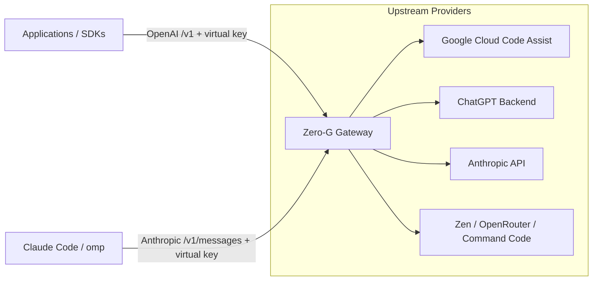

# Gateway

Zero-G is the gateway: apps and coding agents connect directly with a virtual key.

- OpenAI-compatible `/v1` API for every provider; native Anthropic `/v1/messages` for Claude clients.
- Virtual keys with provider and model allowlists, request logs, token usage and the dashboard.
- Provider sign-in, token refresh, credential pooling with failover, and protocol translation.



---

## Endpoint Compatibility Matrix

| Endpoint                                    | Supported Providers            | Notes                                                                                                                      |
| ------------------------------------------- | ------------------------------ | -------------------------------------------------------------------------------------------------------------------------- |
| `/v1/chat/completions`                      | All providers                  | OpenAI chat format; translated providers convert streaming chunks, while passthrough providers forward upstream responses. |
| `/v1/responses`                             | All providers except ChatJimmy | Responses API format; passthrough providers depend on upstream support.                                                    |
| `/v1/models`                                | All providers                  | Aggregated discovery returning `<provider-id>/<model-id>`.                                                                 |
| `/v1/decisions`                             | `openrouter` only              | Native OpenRouter multimodal Decisions API.                                                                                |
| `/v1/messages`, `/v1/messages/count_tokens` | `claude` only                  | Native Anthropic Messages pass-through for Claude Code and other Anthropic clients; plain model names.                     |

**Reasoning replay on translated providers:**

- Resend the full conversation; `previous_response_id` is not supported.
- Codex replays encrypted reasoning, including items without an ID; Antigravity and Claude use signed parts. Keep them for the same provider and model.
- Non-Codex translated routes reject generic reasoning input.
- Keep Chat Completions available for ChatJimmy and upstreams without Responses support.

### Anthropic Clients (Claude Code, omp)

`/v1/messages` forwards Anthropic Messages requests to the `claude` provider's subscription accounts.

| Topic              | Behavior                                                                                       |
| ------------------ | ---------------------------------------------------------------------------------------------- |
| Auth               | Virtual key as `x-api-key` or `Authorization: Bearer`; its provider and model allowlists apply |
| Model names        | Plain, e.g. `claude-sonnet-4-6`                                                                |
| Claude Code bodies | Recognized by their billing block; forwarded byte for byte with only the token swapped         |
| Other clients      | Get Claude Code's billing block, identity line and `metadata.user_id`; the body is re-attested |
| Replies            | Stream back unchanged; logs record input (incl. cache reads/writes) and output tokens          |
| Errors             | Anthropic's `{"type":"error"}` shape                                                           |

```bash
# Claude Code: do not sign in to Claude Code itself.
export ANTHROPIC_BASE_URL=http://127.0.0.1:8080
export ANTHROPIC_AUTH_TOKEN="$ZERO_G_VIRTUAL_KEY"
```

```yaml
# omp (~/.omp/agent/models.yml): the base URL has no /v1 suffix.
providers:
  zero-g-claude:
    baseUrl: http://127.0.0.1:8080
    apiKey: <virtual key>
    api: anthropic-messages
```

### OpenRouter Decisions API Example

```bash
curl http://127.0.0.1:8080/v1/decisions \
  -H "Authorization: Bearer $ZERO_G_VIRTUAL_KEY" \
  -H "Content-Type: application/json" \
  -d '{"model": "openrouter/cloudflare/clef", "state": "A red square",
       "questions": {"is_red": {"type": "noul", "instructions": "Is it red?"}}}'
```

---

## Model capability metadata

`GET /v1/models` keeps the OpenAI-compatible `data` array and may add per-model fields.
**An omitted field means unknown**: not `false`, not empty, and never guessed from the model name.

| Field                                                                  | Meaning                                                          |
| ---------------------------------------------------------------------- | ---------------------------------------------------------------- |
| `context_window`                                                       | Effective combined route context limit, in tokens                |
| `max_output_tokens`                                                    | Output cap the route actually enforces                           |
| `input_modalities`, `output_modalities`                                | `text`, `image`, `audio`, `video`, `pdf`, for this gateway route |
| `supports_tools`                                                       | `false` means no end-to-end OpenAI-compatible tool support       |
| `reasoning`, `supported_reasoning_efforts`, `default_reasoning_effort` | Efforts the route accepts; the default only when known           |

| Provider                            | What discovery reports                                                                                                                                                                                    |
| ----------------------------------- | --------------------------------------------------------------------------------------------------------------------------------------------------------------------------------------------------------- |
| Codex                               | No output limit (no verified cap; client output limits are not forwarded) and tool support unknown. Effort strings, even unknown ones, go to upstream; none is set when omitted.                          |
| Antigravity                         | Tool support unknown. Grouped aliases report capabilities shared by all permitted variants, the smallest known limits, and reject unknown effort levels. Standalone IDs ignore effort and advertise none. |
| Claude                              | `max_input_tokens` is input-only, so no combined `context_window`. Text and image input (no PDF parts), text output.                                                                                      |
| Zen, Go, OpenRouter                 | Only route-relevant metadata from their model lists                                                                                                                                                       |
| ChatJimmy                           | No tools; requests with tool definitions, calls or results are rejected, not stripped                                                                                                                     |
| Custom OpenAI and other passthrough | Upstream fields kept as is; missing ones are not filled in                                                                                                                                                |

---

## Error Handling & Wire Invariants

| Behavior                | Provider Scope                     | Upstream Handling                                                                                                                                            |
| ----------------------- | ---------------------------------- | ------------------------------------------------------------------------------------------------------------------------------------------------------------ |
| **Usage Chunks**        | Codex, Cursor, Antigravity         | Emits final usage chunk when `stream_options.include_usage: true` is requested.                                                                              |
| **Stream Termination**  | Codex, Antigravity                 | Emits `data: [DONE]` on clean close. Interrupted streams yield an error event instead of a silent finish.                                                    |
| **Unsupported Limits**  | Codex                              | Accepts but does not forward `max_tokens` and `max_completion_tokens`; an effective output cap is unknown.                                                   |
| **Strict Wire Options** | Antigravity, Codex, Claude, Cursor | Reject unsupported options (e.g. unknown structured formats, stop sequences, unsupported choice counts) with clear errors instead of dropping them silently. |
| **Claude Billing**      | Claude subscription                | Reports Anthropic's known third-party extra-usage restriction when returned; other upstream error bodies remain private.                                     |

Antigravity stream errors include the upstream error or stream failure detail. These details are visible to the client and stored in request logs.
