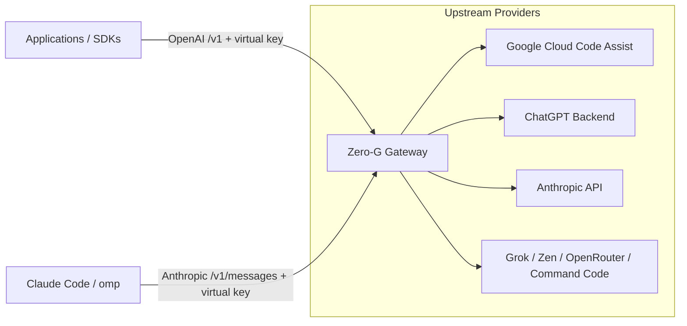

# Gateway

Zero-G is the gateway: applications and coding agents connect to it directly with a virtual key. It serves an OpenAI-compatible `/v1` API for every provider and a native Anthropic `/v1/messages` API for Claude clients.

Zero-G handles virtual keys with provider and model allowlists, request logging and token usage, the observability dashboard, provider authentication, token refreshes, credential pooling and failover, and protocol translation.



---

## Endpoint Compatibility Matrix

| Endpoint | Supported Providers | Notes |
|---|---|---|
| `/v1/chat/completions` | All providers | OpenAI chat format; translated providers convert streaming chunks, while passthrough providers forward upstream responses. |
| `/v1/responses` | All providers except ChatJimmy | Responses API format; passthrough providers depend on upstream support. |
| `/v1/models` | All providers | Aggregated discovery returning `<provider-id>/<model-id>`. |
| `/v1/decisions` | `openrouter` only | Native OpenRouter multimodal Decisions API. |
| `/v1/messages`, `/v1/messages/count_tokens` | `claude` only | Native Anthropic Messages pass-through for Claude Code and other Anthropic clients; plain model names. |

Translated providers require clients to resend the full conversation rather than
using `previous_response_id`. Codex requests encrypted reasoning for replay;
Antigravity and Claude use provider-specific signed parts. Clients must preserve
those parts for the same provider and model. Generic reasoning input is rejected
by non-Codex translated routes. Keep Chat Completions available for ChatJimmy
and upstreams that do not support Responses.

### Anthropic Clients (Claude Code, omp)

`/v1/messages` forwards Anthropic Messages requests to the `claude` provider's
subscription accounts. The virtual key may be sent as `x-api-key` or
`Authorization: Bearer`; the key's provider and model allowlists apply, using
plain model names such as `claude-sonnet-4-6`. Claude Code bodies, recognized by
their billing block, are forwarded byte for byte with only the token swapped.
Other clients receive Claude Code's billing block, identity line, and
`metadata.user_id`, and the body is re-attested. Replies stream back unchanged,
and request logs record input (including cache reads and writes) and output
tokens. Gateway errors use Anthropic's `{"type":"error"}` shape.

```bash
# Claude Code: do not sign in to Claude Code itself.
export ANTHROPIC_BASE_URL=http://127.0.0.1:8080
export ANTHROPIC_AUTH_TOKEN="$ZERO_G_VIRTUAL_KEY"
```

```yaml
# omp (~/.omp/agent/models.yml): the base URL has no /v1 suffix.
providers:
  zero-g-claude:
    baseUrl: http://127.0.0.1:8080
    apiKey: <virtual key>
    api: anthropic-messages
```

### OpenRouter Decisions API Example

```bash
curl http://127.0.0.1:8080/v1/decisions \
  -H "Authorization: Bearer $ZERO_G_VIRTUAL_KEY" \
  -H "Content-Type: application/json" \
  -d '{
    "model": "openrouter/cloudflare/clef",
    "state": "A red square",
    "questions": {
      "is_red": {
        "type": "noul",
        "instructions": "Is it red?"
      }
    }
  }'
```

---

## Model capability metadata

`GET /v1/models` keeps the OpenAI-compatible `data` array and may add these
per-model fields: `context_window`, `max_output_tokens`, `input_modalities`,
`output_modalities`, `supports_tools`, `reasoning`,
`supported_reasoning_efforts`, and `default_reasoning_effort`.

- Token limits are token counts. `context_window` is the effective combined
  route context limit where known; `max_output_tokens` is the output cap the
  route actually enforces.
- Modalities use `text`, `image`, `audio`, `video`, and `pdf`. They describe
  this gateway route, not an upstream API that Zero-G does not expose.
- `supports_tools: false` is an explicit lack of end-to-end OpenAI-compatible
  tool support. Omitted fields are unknown, not `false` and not an empty list.
  ChatJimmy rejects requests containing tool definitions, tool calls or tool
  results rather than silently dropping them.
- Reasoning efforts list the values accepted by the route. The default is only
  shown when the selected route's default is known.
  Codex forwards requested effort strings to its upstream, including unknown
  strings; upstream determines whether they are accepted. When omitted, Zero G
  does not set an effort and the upstream default applies. Antigravity grouped
  aliases select discovered tiered model IDs and reject unknown levels; for
  standalone IDs, an effort is currently ignored and no levels are advertised.

For example, Codex output limits remain omitted: its upstream model discovery
does not provide a verified cap and Zero-G does not forward client output-limit
parameters. Values in a response are provider-specific facts, not defaults for
models that omit them.

Anthropic's `max_input_tokens` is input-only, so Claude discovery does not
publish it as a combined `context_window`. Claude's translated route accepts
text and supported image inputs, but does not expose PDF content parts; its
output is text. When its model list omits a limit, Zero-G does not guess one
from the model name. Other fields remain unknown unless discovery provides
route-relevant metadata.

Discovery varies by provider. Codex output limits and model-specific tool
support remain unknown when not explicitly supplied. Antigravity tool support
is unknown; grouped aliases report only capabilities shared by all permitted
selectable variants and the smallest known limits. Claude combined context is
unknown when only an input limit is available. Zen, Go and OpenRouter publish
only route-relevant metadata supplied by their model lists; unreported output
modalities and other absent fields remain unknown. ChatJimmy does not support
tools. Generic OpenAI-compatible and other passthrough providers retain their
upstream fields, so missing or unverified fields are not filled in.

---

## Error Handling & Wire Invariants

| Behavior | Provider Scope | Upstream Handling |
|---|---|---|
| **Usage Chunks** | Codex, Cursor, Antigravity | Emits final usage chunk when `stream_options.include_usage: true` is requested. |
| **Stream Termination** | Codex, Antigravity | Emits `data: [DONE]` on clean close. Interrupted streams yield an error event instead of a silent finish. |
| **Unsupported Limits** | Codex | Accepts but does not forward `max_tokens` and `max_completion_tokens`; an effective output cap is unknown. |
| **Strict Wire Options** | Antigravity, Codex, Claude, Cursor | Reject unsupported options (e.g. unknown structured formats, stop sequences, unsupported choice counts) with clear errors instead of dropping them silently. |
| **Claude Billing** | Claude subscription | Reports Anthropic's known third-party extra-usage restriction when returned; other upstream error bodies remain private. |
