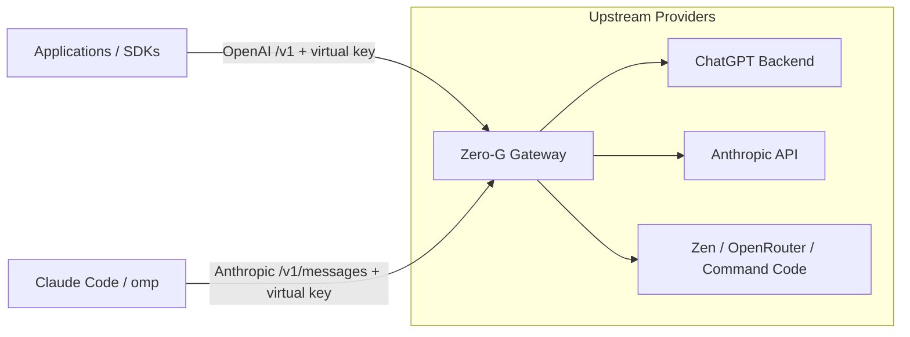

# Gateway

Zero-G is the gateway: apps and coding agents connect directly with a virtual key.

- OpenAI-compatible `/v1` API for every provider; native Anthropic `/v1/messages` for Claude clients.
- Virtual keys with provider and model allowlists, request logs, token usage and the dashboard.
- Provider sign-in, token refresh, credential pooling with failover, and protocol translation.



---

## Endpoint Compatibility Matrix

| Endpoint                                    | Supported Providers            | Notes                                                                                                                      |
| ------------------------------------------- | ------------------------------ | -------------------------------------------------------------------------------------------------------------------------- |
| `/v1/chat/completions`                      | All providers                  | OpenAI chat format; translated providers convert streaming chunks, while passthrough providers forward upstream responses. |
| `/v1/responses`                             | All providers except ChatJimmy | Responses API format; passthrough providers depend on upstream support.                                                    |
| `/v1/models`                                | All providers                  | Aggregated discovery returning `<provider-id>/<model-id>`.                                                                 |
| `/v1/decisions`                             | `openrouter` only              | Native OpenRouter multimodal Decisions API.                                                                                |
| `/v1/messages`, `/v1/messages/count_tokens` | `claude` only                  | Native Anthropic Messages pass-through for Claude Code and omp; plain model names. Claude has no OpenAI-format routes.     |

**Reasoning replay on translated providers:**

- Resend the full conversation; `previous_response_id` is not supported.
- Codex replays encrypted reasoning, including items without an ID; Claude has no translated routes. Keep them for the same provider and model.
- Non-Codex translated routes reject generic reasoning input.
- Keep Chat Completions available for ChatJimmy and upstreams without Responses support.

### Anthropic Clients (Claude Code, omp)

`/v1/messages` forwards Anthropic Messages requests to the `claude` provider's subscription accounts.

| Topic       | Behavior                                                                                                                                                  |
| ----------- | --------------------------------------------------------------------------------------------------------------------------------------------------------- |
| Auth        | Virtual key as `x-api-key` or `Authorization: Bearer`; its provider and model allowlists apply                                                            |
| Model list  | `GET /v1/models` with an `anthropic-version` header returns only Claude models, plain ids, in Anthropic's list shape; the OpenAI-format list omits Claude |
| Model names | Plain, e.g. `claude-sonnet-4-6`                                                                                                                           |
| Bodies      | Forwarded byte for byte with only the token swapped; the client must send its own Claude Code identity (Claude Code and omp do)                           |
| Replies     | Stream back unchanged; logs record input (incl. cache reads/writes) and output tokens                                                                     |
| Errors      | Anthropic's `{"type":"error"}` shape                                                                                                                      |

```bash
# Claude Code: do not sign in to Claude Code itself.
export ANTHROPIC_BASE_URL=http://127.0.0.1:8080
export ANTHROPIC_AUTH_TOKEN="$ZERO_G_VIRTUAL_KEY"
```

```yaml
# omp (~/.omp/agent/models.yml): the base URL has no /v1 suffix.
providers:
  zero-g-claude:
    baseUrl: http://127.0.0.1:8080
    apiKey: <virtual key>
    api: anthropic-messages
```

### Interactive Antigravity CLI observations

The opt-in `PostInvocation` hook records interactive `agy` activity without routing model traffic through Zero-G or sharing Google credentials. It requires Python 3 and a Zero-G virtual key. Export these variables in the environment that launches `agy` (use HTTPS when the gateway is remote):

The former `agy` inference provider and its model routes have been retired. A saved **Google Antigravity** provider entry now only displays quota (see below); it serves no model routes. The observations endpoint and hook remain available independently.
The collector requires a virtual key without a provider allowlist; model restrictions still apply. Provider-scoped keys cannot submit observations.

```bash
export ZERO_G_URL=http://127.0.0.1:8080  # gateway root, without /v1
export ZERO_G_VIRTUAL_KEY='<virtual key>'
agy
```

Merge this entry into `.agents/hooks.json` in the workspace, or `~/.gemini/config/hooks.json` for all workspaces. Replace the path with the absolute path to this checkout; keep existing hooks. The global hook file is shared with other Antigravity products. See the [official hooks documentation](https://antigravity.google/docs/hooks/) and use `/hooks` in `agy` to inspect loaded hooks.

```json
{
  "zero-g-observations": {
    "PostInvocation": [
      {
        "type": "command",
        "command": "python3 /absolute/path/to/zero-g/scripts/agy-observe.py",
        "timeout": 5
      }
    ]
  }
}
```

The hook sends the first completed model response transcript record at or after `initialNumSteps` and the hook's `lastUserInput` to `POST /v1/agy/observations`, authenticated with the virtual key. These are **not full wire-level request logs**: the request contains only the last user input, and the response is the transcript record, potentially including thinking, tool arguments, cached-token counts and truncated content. Prompts and responses can contain secrets or sensitive code; they are sent to and stored by Zero-G. Only enable this for a gateway and virtual key you trust. Remove or disable the hook to stop collection.

Collection is best effort: missing or incomplete records, transcript format changes, a response outside the final 2 MiB, network errors and timeouts can cause observations to be skipped without interrupting `agy`. Missing token counts are sent as null, not estimated. Observed `input_tokens` exclude cached input; `cache_read_tokens`, if supplied, remains in the response record rather than being added. No live `agy` verification is claimed.

These imported records have no measured request duration; the dashboard currently displays their latency as 0 ms. The hook is independent of model traffic, but Google's terms do not explicitly address exporting transcript data to Zero-G. Check the terms for your account before enabling it.

### Antigravity quota from the official CLI

Zero-G never calls Google for Antigravity quota. The official `agy` CLI already knows it: `agy --print /usage --output-format json` prints each model pool's 5-hour and weekly limits, uses no tokens, and runs with the login `agy` already has. `scripts/agy-quota.py` runs that command and pushes the result to `POST /v1/agy/quota`; the dashboard then shows it on the **Google Antigravity** credential card.

Setup:

1. Under **Models → Providers → Google Antigravity**, add one credential per Google account, named after the account (for example `Kien`). There is no sign-in: the card shows as connected once a report arrives.
2. On each machine where `agy` is signed in, set the variables below and run the script every 10 to 15 minutes. The same unrestricted virtual key as the observation hook works.

```bash
export ZERO_G_URL=http://127.0.0.1:8080       # gateway root, without /v1
export ZERO_G_VIRTUAL_KEY='<virtual key>'     # no provider allowlist
export ZERO_G_AGY_ACCOUNT='Kien'              # the credential name in Zero-G
python3 /absolute/path/to/zero-g/scripts/agy-quota.py
```

```cron
*/15 * * * * ZERO_G_URL=https://zero-g.example.com ZERO_G_VIRTUAL_KEY=... ZERO_G_AGY_ACCOUNT=Kien python3 /absolute/path/to/zero-g/scripts/agy-quota.py
```

| Topic             | Behavior                                                                                                                                                                                                                                                                                                                                                                                                                                       |
| ----------------- | ---------------------------------------------------------------------------------------------------------------------------------------------------------------------------------------------------------------------------------------------------------------------------------------------------------------------------------------------------------------------------------------------------------------------------------------------- |
| Matching          | The credential is found by name, ignoring case and surrounding spaces. An unknown name is rejected with 404.                                                                                                                                                                                                                                                                                                                                   |
| Freshness         | The card shows the last report. If none arrived for 3 hours it shows an error naming the script instead of old numbers.                                                                                                                                                                                                                                                                                                                        |
| Subscription tier | The script also sends the account's tier (for example `Google AI Pro`) and the credential card shows it next to the name. agy only reports it through its ACP server, and each read leaves a small throwaway conversation file (about 400 KB) in agy's own storage, so the script reads it at most once a day (`AGY_TIER_REFRESH_HOURS`, default 24) and resends the cached value. If it cannot be read, the quota is still pushed without it. |
| Reset times       | A pool that has not started a window reports no reset time; the card shows none.                                                                                                                                                                                                                                                                                                                                                               |
| Errors            | The script exits non-zero and prints the reason when `agy` output is unexpected or Zero-G refuses the report.                                                                                                                                                                                                                                                                                                                                  |

### OpenRouter Decisions API Example

```bash
curl http://127.0.0.1:8080/v1/decisions \
  -H "Authorization: Bearer $ZERO_G_VIRTUAL_KEY" \
  -H "Content-Type: application/json" \
  -d '{"model": "openrouter/cloudflare/clef", "state": "A red square",
       "questions": {"is_red": {"type": "noul", "instructions": "Is it red?"}}}'
```

---

## Model capability metadata

`GET /v1/models` keeps the OpenAI-compatible `data` array and may add per-model fields.
**An omitted field means unknown**: not `false`, not empty, and never guessed from the model name.

| Field                                                                  | Meaning                                                          |
| ---------------------------------------------------------------------- | ---------------------------------------------------------------- |
| `context_window`                                                       | Effective combined route context limit, in tokens                |
| `max_output_tokens`                                                    | Output cap the route actually enforces                           |
| `input_modalities`, `output_modalities`                                | `text`, `image`, `audio`, `video`, `pdf`, for this gateway route |
| `supports_tools`                                                       | `false` means no end-to-end OpenAI-compatible tool support       |
| `reasoning`, `supported_reasoning_efforts`, `default_reasoning_effort` | Efforts the route accepts; the default only when known           |

| Provider                            | What discovery reports                                                                                                                                                           |
| ----------------------------------- | -------------------------------------------------------------------------------------------------------------------------------------------------------------------------------- |
| Codex                               | No output limit (no verified cap; client output limits are not forwarded) and tool support unknown. Effort strings, even unknown ones, go to upstream; none is set when omitted. |
| Claude                              | `max_input_tokens` is input-only, so no combined `context_window`. Text and image input (no PDF parts), text output.                                                             |
| Zen, Go, OpenRouter                 | Only route-relevant metadata from their model lists                                                                                                                              |
| ChatJimmy                           | No tools; requests with tool definitions, calls or results are rejected, not stripped                                                                                            |
| Custom OpenAI and other passthrough | Upstream fields kept as is; missing ones are not filled in                                                                                                                       |

---

## Error Handling & Wire Invariants

| Behavior                | Provider Scope | Upstream Handling                                                                                                                                            |
| ----------------------- | -------------- | ------------------------------------------------------------------------------------------------------------------------------------------------------------ |
| **Usage Chunks**        | Codex, Cursor  | Emits final usage chunk when `stream_options.include_usage: true` is requested.                                                                              |
| **Stream Termination**  | Codex          | Emits `data: [DONE]` on clean close. Interrupted streams yield an error event instead of a silent finish.                                                    |
| **Unsupported Limits**  | Codex          | Accepts but does not forward `max_tokens` and `max_completion_tokens`; an effective output cap is unknown.                                                   |
| **Strict Wire Options** | Codex, Cursor  | Reject unsupported options (e.g. unknown structured formats, stop sequences, unsupported choice counts) with clear errors instead of dropping them silently. |
