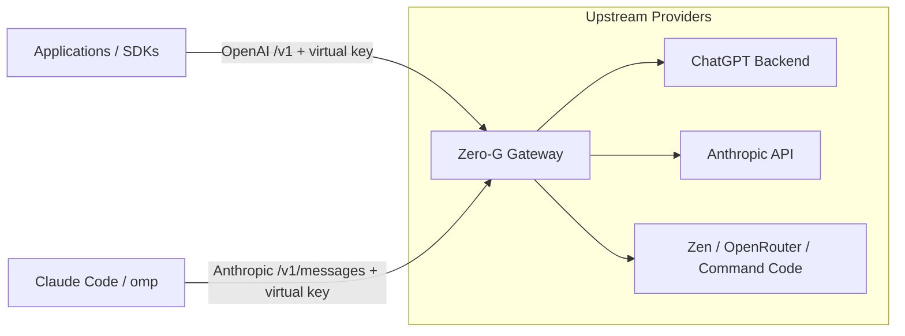

# Gateway

Zero-G is the gateway: apps and coding agents connect directly with a virtual key.

- OpenAI-compatible `/v1` API for every model-serving provider except Claude; native Anthropic `/v1/messages` for Claude clients.
- Virtual keys with provider and model allowlists, request logs, token usage and the dashboard.
- Provider sign-in, token refresh, credential pooling with failover, and protocol translation.



---

## Endpoint Compatibility Matrix

| Endpoint                                    | Supported Providers                   | Notes                                                                                                                                                         |
| ------------------------------------------- | ------------------------------------- | ------------------------------------------------------------------------------------------------------------------------------------------------------------- |
| `/v1/chat/completions`                      | All except `claude`, `agy`            | OpenAI chat format; translated providers convert streaming chunks, while passthrough providers forward upstream responses.                                    |
| `/v1/responses`                             | All except ChatJimmy, `claude`, `agy` | Responses API format; passthrough providers depend on upstream support.                                                                                       |
| `/v1/models`                                | All except `claude`, `agy`            | Aggregated discovery returning `<provider-id>/<model-id>`. Claude models are listed only to Anthropic clients (see [Claude Code and omp](claude-and-omp.md)). |
| `/v1/decisions`                             | `openrouter` only                     | Native OpenRouter multimodal Decisions API.                                                                                                                   |
| `/v1/messages`, `/v1/messages/count_tokens` | `claude` only                         | Native Anthropic Messages pass-through for Claude Code and omp; plain model names. Claude has no OpenAI-format routes.                                        |

**Reasoning replay on translated providers:**

- Resend the full conversation; `previous_response_id` is not supported.
- Codex replays encrypted reasoning, including items without an ID. Keep them for the same provider and model.
- Non-Codex translated routes reject generic reasoning input.
- Keep Chat Completions available for ChatJimmy and upstreams without Responses support.

### Anthropic Clients (Claude Code, omp)

`/v1/messages` forwards Anthropic Messages requests, unchanged, to the `claude` provider's subscription accounts. Setup, request handling and troubleshooting are in [Claude Code and omp](claude-and-omp.md).

### Antigravity CLI (observations and quota)

Two independent features for the official `agy` CLI. Neither routes model traffic through Zero-G or shares Google credentials. The former `agy` inference provider and its model routes have been retired: a saved **Google Antigravity** provider entry only displays quota and serves no model routes.

Both need Python 3 and a virtual key without a provider allowlist (model restrictions still apply; provider-scoped keys are refused), and these variables in the environment that runs them (use HTTPS when the gateway is remote):

```bash
export ZERO_G_URL=http://127.0.0.1:8080  # gateway root, without /v1
export ZERO_G_VIRTUAL_KEY='<virtual key>'
```

#### Interactive observations

The opt-in `PostInvocation` hook sends a record of each interactive `agy` model response to Zero-G, so that activity shows up in the request logs. Model traffic itself does not go through Zero-G.

> **Privacy:** prompts and responses can contain secrets or sensitive code, and they are stored by Zero-G. Only enable this for a gateway and virtual key you trust. Google's terms do not explicitly address exporting transcript data to Zero-G, so check the terms for your account first.

**Setup**

1. Export the variables above in the environment that launches `agy`.
2. Merge this entry into `.agents/hooks.json` (one workspace) or `~/.gemini/config/hooks.json` (all workspaces; the file is shared with other Antigravity products). Use the absolute path to this checkout and keep any existing hooks.

   ```json
   {
     "zero-g-observations": {
       "PostInvocation": [
         {
           "type": "command",
           "command": "python3 /absolute/path/to/zero-g/scripts/agy-observe.py",
           "timeout": 5
         }
       ]
     }
   }
   ```

3. Run `/hooks` in `agy` to confirm the hook loaded (see the [official hooks documentation](https://antigravity.google/docs/hooks/)). To stop collection, remove or disable the hook.

**What is sent**

| Item     | Details                                                                                                                                                |
| -------- | ------------------------------------------------------------------------------------------------------------------------------------------------------ |
| Where    | `POST /v1/agy/observations`, authenticated with the virtual key                                                                                        |
| Record   | The first completed model response transcript record at or after `initialNumSteps`. These are **not full wire-level request logs**.                    |
| Request  | Only the hook's `lastUserInput`                                                                                                                        |
| Response | The transcript record itself, which can include thinking, tool arguments, cached-token counts and truncated content                                    |
| Tokens   | Missing counts are sent as null, never estimated. `input_tokens` exclude cached input; `cache_read_tokens`, if supplied, stays in the response record. |
| Latency  | No request duration is measured, so the dashboard shows 0 ms                                                                                           |

**Limits**

- Collection is best effort and never interrupts `agy`. Missing or incomplete records, transcript format changes, a response outside the final 2 MiB, network errors and timeouts can all cause an observation to be skipped.
- No live `agy` verification of the hook is claimed.

#### Quota from the official CLI

Zero-G never calls Google for Antigravity quota. The official `agy` CLI already knows it: `agy --print /usage --output-format json` prints each model pool's 5-hour and weekly limits, uses no tokens, and runs with the login `agy` already has. The `zero-g-agy-quota` collector runs that command and pushes the result to `POST /v1/agy/quota`; the dashboard then shows it on the **Google Antigravity** credential card.

The collector is built and released with Zero-G and always has the same version number. Prebuilt static binaries for Linux (x86-64 and arm64) are attached to each [GitHub release](https://github.com/Delnegend/zero-g/releases); Homebrew installs and updates them for you.

Setup:

1. Under **Models → Providers → Google Antigravity**, add one credential per Google account, named after the account. There is no sign-in: the card shows as connected once a report arrives.
2. On each machine where `agy` is signed in, install the collector and give it a settings file. The virtual key must not have a provider allowlist.

   ```bash
   brew tap Delnegend/tap
   brew install zero-g-agy-quota

   mkdir -p ~/.config/zero-g
   cat > ~/.config/zero-g/agy-quota.env <<'EOF'
   ZERO_G_URL=https://zero-g.example.com
   ZERO_G_VIRTUAL_KEY=<virtual key>
   ZERO_G_AGY_ACCOUNT=<credential name>
   EOF
   chmod 600 ~/.config/zero-g/agy-quota.env
   ```

3. Start it as a background service. It reports at start and then every 15 minutes, and `brew upgrade` keeps it current.

   ```bash
   brew services start zero-g-agy-quota
   ```

4. To check it by hand, run `zero-g-agy-quota` once: it prints nothing on success and the reason on failure. Service logs are in `$(brew --prefix)/var/log/`.

Without Homebrew, download the archive for your platform from the release page and run `zero-g-agy-quota` from cron or a systemd timer. Settings come from the environment or the settings file (`--config FILE` to use another path); environment variables win. `zero-g-agy-quota --help` lists them all.

| Topic             | Behavior                                                                                                                                                                                                                                                                                                                                                                                                                                             |
| ----------------- | ---------------------------------------------------------------------------------------------------------------------------------------------------------------------------------------------------------------------------------------------------------------------------------------------------------------------------------------------------------------------------------------------------------------------------------------------------- |
| Matching          | The credential is found by name, ignoring case and surrounding spaces. An unknown name is rejected with 404.                                                                                                                                                                                                                                                                                                                                         |
| Freshness         | The card shows the last report. If none arrived for 3 hours it shows an error naming the collector instead of old numbers.                                                                                                                                                                                                                                                                                                                           |
| Subscription tier | The collector also sends the account's tier (for example `Google AI Pro`) and the credential card shows it next to the name. agy only reports it through its ACP server, and each read leaves a small throwaway conversation file (about 400 KB) in agy's own storage, so the collector reads it at most once a day (`AGY_TIER_REFRESH_HOURS`, default 24) and resends the cached value. If it cannot be read, the quota is still pushed without it. |
| Reset times       | A pool that has not started a window reports no reset time; the card shows none.                                                                                                                                                                                                                                                                                                                                                                     |
| Errors            | The collector exits non-zero and prints the reason when `agy` output is unexpected or Zero-G refuses the report.                                                                                                                                                                                                                                                                                                                                     |

### OpenRouter Decisions API Example

```bash
curl http://127.0.0.1:8080/v1/decisions \
  -H "Authorization: Bearer $ZERO_G_VIRTUAL_KEY" \
  -H "Content-Type: application/json" \
  -d '{"model": "openrouter/cloudflare/clef", "state": "A red square",
       "questions": {"is_red": {"type": "noul", "instructions": "Is it red?"}}}'
```

---

## Model capability metadata

`GET /v1/models` keeps the OpenAI-compatible `data` array and may add per-model fields.
**An omitted field means unknown**: not `false`, not empty, and never guessed from the model name.

| Field                                                                  | Meaning                                                          |
| ---------------------------------------------------------------------- | ---------------------------------------------------------------- |
| `context_window`                                                       | Effective combined route context limit, in tokens                |
| `max_output_tokens`                                                    | Output cap the route actually enforces                           |
| `input_modalities`, `output_modalities`                                | `text`, `image`, `audio`, `video`, `pdf`, for this gateway route |
| `supports_tools`                                                       | `false` means no end-to-end OpenAI-compatible tool support       |
| `reasoning`, `supported_reasoning_efforts`, `default_reasoning_effort` | Efforts the route accepts; the default only when known           |

| Provider                            | What discovery reports                                                                                                                                                           |
| ----------------------------------- | -------------------------------------------------------------------------------------------------------------------------------------------------------------------------------- |
| Codex                               | No output limit (no verified cap; client output limits are not forwarded) and tool support unknown. Effort strings, even unknown ones, go to upstream; none is set when omitted. |
| Claude                              | Not in the OpenAI-format list. Anthropic clients get Anthropic's own model fields unchanged.                                                                                     |
| Zen, Go, OpenRouter                 | Only route-relevant metadata from their model lists                                                                                                                              |
| ChatJimmy                           | No tools; requests with tool definitions, calls or results are rejected, not stripped                                                                                            |
| Custom OpenAI and other passthrough | Upstream fields kept as is; missing ones are not filled in                                                                                                                       |

---

## Error Handling & Wire Invariants

| Behavior                | Provider Scope | Upstream Handling                                                                                                                                            |
| ----------------------- | -------------- | ------------------------------------------------------------------------------------------------------------------------------------------------------------ |
| **Usage Chunks**        | Codex, Cursor  | Emits final usage chunk when `stream_options.include_usage: true` is requested.                                                                              |
| **Stream Termination**  | Codex          | Emits `data: [DONE]` on clean close. Interrupted streams yield an error event instead of a silent finish.                                                    |
| **Unsupported Limits**  | Codex          | Accepts but does not forward `max_tokens` and `max_completion_tokens`; an effective output cap is unknown.                                                   |
| **Strict Wire Options** | Codex, Cursor  | Reject unsupported options (e.g. unknown structured formats, stop sequences, unsupported choice counts) with clear errors instead of dropping them silently. |
