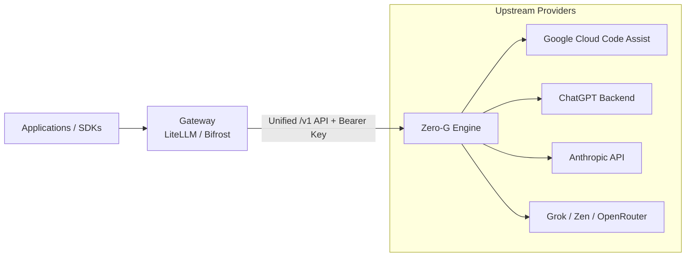

# Gateway Integration

Zero-G is built to sit behind OpenAI-compatible routing gateways (such as **LiteLLM** or **Bifrost**). 

The gateway handles rate-limiting, organizational budgets, and user routing. Zero-G handles provider authentication, token refreshes, credential pooling, and protocol translation.



---

## Gateway Comparison & Setup

| Gateway | Config Format | Base URL Pattern | Key Feature Support |
|---|---|---|---|
| **LiteLLM** | YAML (`model_list`) | `http://zero-g:8080/v1` | Per-model routing, load balancing, cost tracking. |
| **Bifrost** | JSON (`providers`) | `http://zero-g:8080` (Bifrost appends `/v1`) | Direct custom OpenAI provider pass-through. |

---

## Configuration Examples

### LiteLLM Configuration

Add deployments to `config.yaml`:

```yaml
model_list:
  - model_name: agy-claude
    litellm_params:
      model: openai/agy/claude-sonnet-5-5-medium
      api_base: http://zero-g:8080/v1
      api_key: os.environ/ZERO_G_VIRTUAL_KEY

  - model_name: codex-gpt5
    litellm_params:
      model: openai/codex/gpt-5.3-codex
      api_base: http://zero-g:8080/v1
      api_key: os.environ/ZERO_G_VIRTUAL_KEY

  - model_name: zen-beam
    litellm_params:
      model: openai/zen/beam-free
      api_base: http://zero-g:8080/v1
      api_key: os.environ/ZERO_G_VIRTUAL_KEY
```

### Bifrost Configuration

Configure a custom provider in `bifrost.json`:

```json
{
  "providers": {
    "zero-g": {
      "keys": [
        { "name": "zero-g", "value": "<ZERO_G_VIRTUAL_KEY>", "models": ["*"] }
      ],
      "network_config": { 
        "base_url": "http://zero-g:8080" 
      },
      "custom_provider_config": {
        "base_provider_type": "openai",
        "allowed_requests": {
          "list_models": true,
          "chat_completion": true,
          "chat_completion_stream": true,
          "responses": true,
          "responses_stream": true
        }
      }
    }
  }
}
```

---

## Endpoint Compatibility Matrix

| Endpoint | Supported Providers | Notes |
|---|---|---|
| `/v1/chat/completions` | All providers | OpenAI chat format; translated providers convert streaming chunks, while passthrough providers forward upstream responses. |
| `/v1/responses` | All providers except ChatJimmy | Responses API format; passthrough providers depend on upstream support. |
| `/v1/models` | All providers | Aggregated discovery returning `<provider-id>/<model-id>`. |
| `/v1/decisions` | `openrouter` only | Native OpenRouter multimodal Decisions API. |

### OpenRouter Decisions API Example

```bash
curl http://127.0.0.1:8080/v1/decisions \
  -H "Authorization: Bearer $ZERO_G_VIRTUAL_KEY" \
  -H "Content-Type: application/json" \
  -d '{
    "model": "openrouter/cloudflare/clef",
    "state": "A red square",
    "questions": {
      "is_red": {
        "type": "noul",
        "instructions": "Is it red?"
      }
    }
  }'
```

---

## Model capability metadata

`GET /v1/models` keeps the OpenAI-compatible `data` array and may add these
per-model fields: `context_window`, `max_output_tokens`, `input_modalities`,
`output_modalities`, `supports_tools`, `reasoning`,
`supported_reasoning_efforts`, and `default_reasoning_effort`.

- Token limits are token counts. `context_window` is the effective combined
  route context limit where known; `max_output_tokens` is the output cap the
  route actually enforces.
- Modalities use `text`, `image`, `audio`, `video`, and `pdf`. They describe
  this gateway route, not an upstream API that Zero-G does not expose.
- `supports_tools: false` is an explicit lack of end-to-end OpenAI-compatible
  tool support. Omitted fields are unknown, not `false` and not an empty list.
  ChatJimmy rejects requests containing tool definitions, tool calls or tool
  results rather than silently dropping them.
- Reasoning efforts list the values accepted by the route. The default is only
  shown when the selected route's default is known.
  Codex forwards requested effort strings to its upstream, including unknown
  strings; upstream determines whether they are accepted. When omitted, Zero G
  does not set an effort and the upstream default applies. Antigravity grouped
  aliases select discovered tiered model IDs and reject unknown levels; for
  standalone IDs, an effort is currently ignored and no levels are advertised.

For example, Codex output limits remain omitted: its upstream model discovery
does not provide a verified cap and Zero-G does not forward client output-limit
parameters. Values in a response are provider-specific facts, not defaults for
models that omit them.

Anthropic's `max_input_tokens` is input-only, so Claude discovery does not
publish it as a combined `context_window`. Claude's translated route accepts
text and supported image inputs, but does not expose PDF content parts; its
output is text. When its model list omits a limit, Zero-G does not guess one
from the model name. Other fields remain unknown unless discovery provides
route-relevant metadata.

Discovery varies by provider. Codex output limits and model-specific tool
support remain unknown when not explicitly supplied. Antigravity tool support
is unknown; grouped aliases report only capabilities shared by all permitted
selectable variants and the smallest known limits. Claude combined context is
unknown when only an input limit is available. Zen, Go and OpenRouter publish
only route-relevant metadata supplied by their model lists; unreported output
modalities and other absent fields remain unknown. ChatJimmy does not support
tools. Generic OpenAI-compatible and other passthrough providers retain their
upstream fields, so missing or unverified fields are not filled in.

---

## Error Handling & Wire Invariants

| Behavior | Provider Scope | Upstream Handling |
|---|---|---|
| **Usage Chunks** | Codex, Cursor, Antigravity | Emits final usage chunk when `stream_options.include_usage: true` is requested. |
| **Stream Termination** | Codex, Antigravity | Emits `data: [DONE]` on clean close. Interrupted streams yield an error event instead of a silent finish. |
| **Unsupported Limits** | Codex | Accepts but does not forward `max_tokens` and `max_completion_tokens`; an effective output cap is unknown. |
| **Strict Wire Options** | Antigravity, Codex, Claude, Cursor | Reject unsupported options (e.g. unknown structured formats, stop sequences, unsupported choice counts) with clear errors instead of dropping them silently. |
